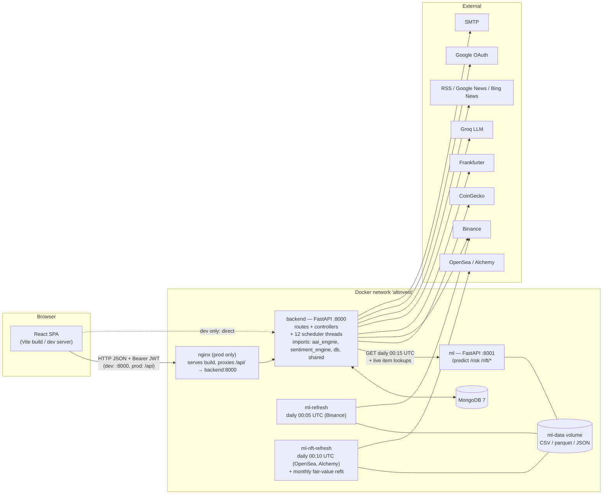
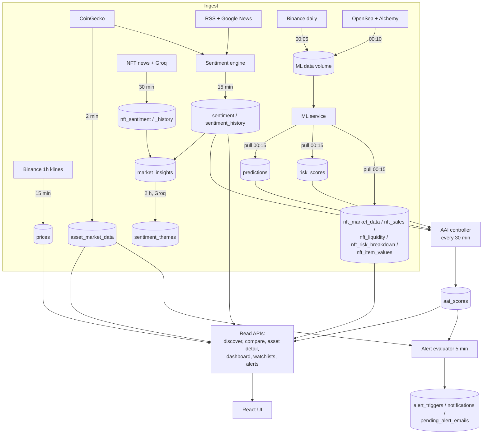
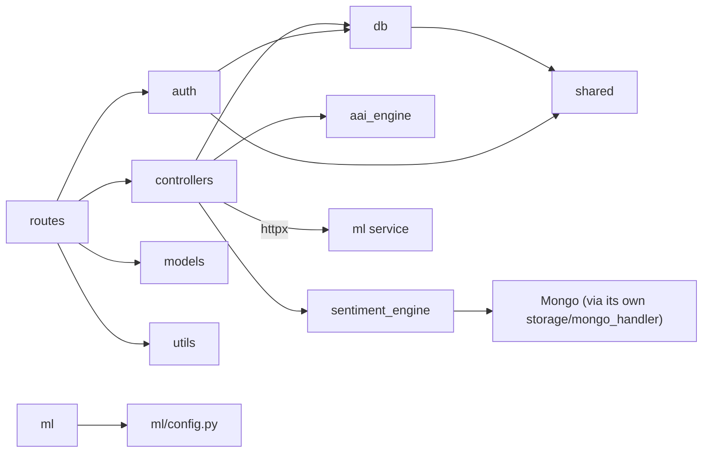
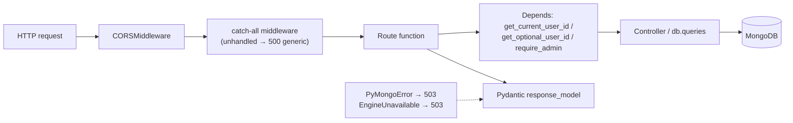
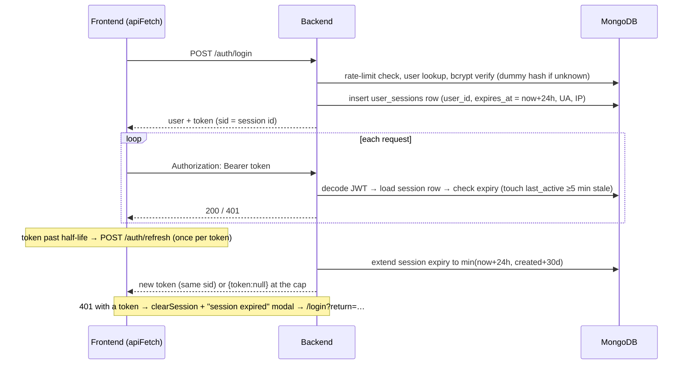
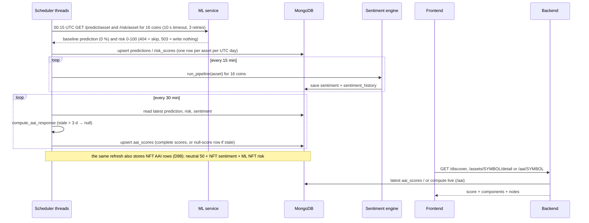
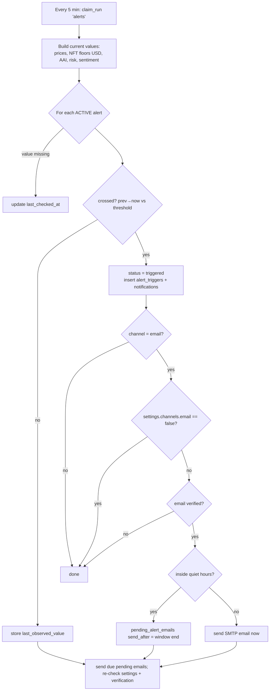
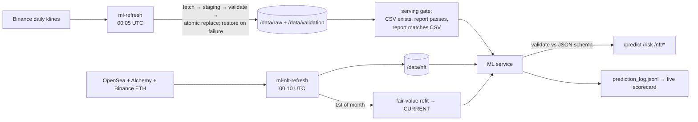

# AltInvest — Project Specification

> **Status of this document:** generated from the repository on `main` (HEAD `2189e8e`, 2026-11-20; includes D97 and D98) by reading the source code.
> Docs, READMEs and audit files were used as pointers, but every behavioural claim below was checked against code unless it is
> explicitly marked **[not verified]** (could not be confirmed from the repo) or **[from docs]** (stated in a project document, not re-traced in code).
> No stack was started and no test suite was run while writing this; test counts are therefore taken from the repo's own docs or counted from source (see §11).
> No secrets appear here: environment variables are listed by name only.

## Contents

1. [Project overview](#1-project-overview)
2. [Technology stack](#2-technology-stack)
3. [System architecture](#3-system-architecture)
4. [Codebase structure](#4-codebase-structure)
5. [Functional specification](#5-functional-specification)
6. [Frontend and backend](#6-frontend-and-backend)
7. [Database design](#7-database-design)
8. [API documentation](#8-api-documentation)
9. [Workflows and integrations](#9-workflows-and-integrations)
10. [Infrastructure and deployment](#10-infrastructure-and-deployment)
11. [Testing, security and error handling](#11-testing-security-and-error-handling)
12. [Project status and future scope](#12-project-status-and-future-scope)
13. [Appendix: discrepancies found while writing this document](#13-appendix-discrepancies-found-while-writing-this-document)

---

## 1. Project overview

### 1.1 Purpose and problem statement

AltInvest (internal API title *"AAIP Backend — Alternative Asset Intelligence Platform"*) is a final-year (LY) project at Somaiya. It is an
**analytics platform for alternative investments: crypto assets and blue-chip NFT collections.** Retail investors looking at these markets
face scattered information (prices on one site, news on another, risk numbers nowhere) and a lot of unvalidated "AI prediction" marketing.
AltInvest brings prices, news sentiment and a risk measure together into one number per asset, the **Alternative Asset Index (AAI)**, and
shows it next to the user's portfolio, watchlists and alerts.

A deliberate design stance runs through the whole code base: **it is built to be honest about what it knows.**

- An ML number is served only if it beat a simple baseline on held-out data. Where nothing did, the baseline is served and the response says so
  (`note`, `model_version = "baseline-last-value"`).
- Missing inputs are `null`, never made-up defaults. The AAI is `null` when an input is missing or stale.
- Seed scripts no longer write predictions, risk or AAI rows (`db/seed_all.py` docstring, decision D94).
- Every price carries `price_as_of` and a "delayed" flag.
- The UI shows a "not financial advice" disclaimer on every app page, and the AAI band is shown as a *rating* (Strong / Neutral / Weak), not as BUY/SELL advice.

### 1.2 Objectives and proposed solution

| Objective | How the code meets it |
|---|---|
| One comparable score per asset | `aai_engine/aai.py`: `AAI = 0.40 × prediction + 0.30 × sentiment + 0.30 × risk` (each 0–100), BUY ≥ 55, HOLD 45–55, SELL < 45 (the band is applied in `backend/controllers/market_controller.py`, not in the engine). NFT collections get the same formula with the prediction part fixed at a neutral 50 (`compute_nft_aai`, D98), so an NFT score lies in [20, 80]. |
| Real market data | CoinGecko (snapshots every 2 min), Binance hourly klines (every 15 min), NFT floors/sales via OpenSea, traits via Alchemy — all pulled by background jobs. |
| News sentiment | RSS + per-coin Google News → VADER + FinBERT ensemble, blended with market signals. NFT news scored by an LLM on Groq. |
| Honest ML | A separate ML service with a sealed test set, walk-forward evaluation and approval rules; it serves baselines when no model is approved. |
| Personal tracking | Portfolio (atomic buys/sells, cost basis, P&L), watchlists, rule-based alerts with in-app and email delivery. |
| Account safety | Verified-email signup, bcrypt, session-bound JWTs, rate limits, Google sign-in, data export and deletion. |

### 1.3 Target users and use cases

Target users (inferred from the product surface; no persona document exists in the repo): individual retail investors and students interested in
crypto and NFT collections who want a research/analytics view rather than a trading venue. AltInvest does **not** execute trades or hold funds.

| Use case | Where |
|---|---|
| "What is the market mood today?" | Dashboard, Sentiment page |
| "Which coins/collections look strong, and why?" | Discover, Asset detail, NFT collection page |
| "How do these assets compare?" | Compare page (up to a fixed maximum of items) |
| "How is my portfolio doing and how concentrated is it?" | Portfolio page, portfolio intelligence |
| "Tell me when X crosses a level" | Alerts (price, AAI, risk, sentiment) → in-app + optional email |
| "What might my NFT be worth?" | NFT collection page item lookup, NFT holdings estimate (ML fair value) |

### 1.4 Core features (summary)

Implemented and detailed in §5: email/password + Google authentication; 5-step onboarding with "home focus"; Dashboard; Discover; Compare;
Asset detail; NFT collection page; Sentiment hub; Portfolio with transactions and intelligence; Watchlists; Alerts; Notifications; global
search with history; Settings (preferences, appearance, notifications, security, connected accounts); Profile; display-currency conversion
(FX); account export and deletion; admin-only forced sentiment refresh.

### 1.5 What is "real" today (coverage)

| Area | Coverage in code |
|---|---|
| Coins in the `assets` seed list | 17 (`SOURCES` in `backend/controllers/market_data_controller.py`) — BTC, ETH, SOL, BNB, XRP, ADA, AVAX, DOGE, DOT, LINK, MATIC (POL), UNI, LTC, ATOM, NEAR, ARB, DAI |
| Coins with sentiment | 16 (`ASSETS` in `sentiment_engine/utils/config.py`; everything above except DAI) |
| Coins with ML prediction/risk → AAI | **16** (`ML_COVERED_ASSETS` in `db/queries.py`, = `SERVED_ASSETS` in `ml/config.py`). DAI is *not covered*: `/prediction/DAI` and `/risk/DAI` return 404 and its AAI is `null` with `covered: false`. |
| NFT AAI | Since D98 each of the 7 collections has an AAI (neutral prediction 50, NFT news sentiment, ML NFT risk; range 20–80; not comparable to crypto AAI) |
| NFT collections | 7: `boredapeyachtclub`, `mutant-ape-yacht-club`, `pudgypenguins`, `lilpudgys`, `azuki`, `doodles-official`, `milady` (`NFT_SLUGS` in `ml/config.py`) |
| What the ML service actually serves | Crypto price = last value ("no change", 0 %); crypto direction = `UNCERTAIN`; crypto risk = 30-day volatility ranked 0–100; NFT floor risk = 30-day floor volatility; NFT item fair value = pooled LightGBM (6 collections) or B2 baseline (`lilpudgys`), refit monthly. |

> **Documentation conflict:** `README.md` and `ml/README.md` still say ML covers "BTC, ETH and SOL only"; the code (and the audit) say **16 coins**. See §13.

---

## 2. Technology stack

### 2.1 Languages and runtimes

| Technology | Version (source) | Used for |
|---|---|---|
| Python | 3.11 (backend image), 3.12 (ML image) | Backend, sentiment engine, AAI engine, ML service, DB scripts |
| JavaScript (ES modules, JSX) | Node 22 (Dockerfiles, CI) | Frontend |
| MongoDB | 7 (`mongo:7` image) | Only database; Atlas is also supported by URI |
| Bash/PowerShell/YAML | — | Docker, compose, CI |

### 2.2 Frontend (`frontend/package.json`)

| Library | Version | Purpose / where |
|---|---|---|
| React / React DOM | ^19.2.6 | UI framework |
| Vite (+ `@vitejs/plugin-react`) | ^8.0.12 / ^6.0.1 | Dev server (HMR, `server.warmup`, polling in Docker on Windows) and production build |
| react-router-dom | ^7.15.1 | Client-side routing (`BrowserRouter`) in `src/App.jsx`, `src/routes.js` |
| Tailwind CSS 4 (`@tailwindcss/postcss`), `tailwind-merge`, `class-variance-authority`, `clsx`, `tw-animate-css` | ^4.3.0 … | Utility styling; most pages also use hand-written CSS in `src/styles/*.css` with CSS variables (`tokens.css`) |
| radix-ui, lucide-react | ^1.4.3 / ^1.16.0 | Accessible primitives and icons (a local `components/icons/index.jsx` is also used) |
| framer-motion / motion | ^12.38.0 | Animations (landing page and UI) |
| `ogl`, `three`, `@react-three/fiber`, `@react-three/drei` | ^1.0.11 / ^0.184 / ^9.6 / ^10.7 | Listed dependencies. `ogl` backs the landing-page aurora effect (`motionEffects/SoftAurora`). Use of `three`/`drei` was **[not verified]**. |
| `@fontsource-variable/geist` | ^5.2.9 | Font (DM Sans is loaded from Google Fonts per the CSP) |
| ESLint 10 + react-hooks + react-refresh plugins | ^10.3.0 | Lint (`npm run lint`) |
| `shadcn` (CLI) | ^4.7.0 (devDependency) | Component generator; `components.json` present |
| Node built-in test runner | — | `npm test` = `node --test "src/**/*.test.js"` (pure-function tests only) |

No state-management library (Redux, Zustand, …) is used; see §6.1.

### 2.3 Backend (`backend/requirements.txt`, the image's single lock file — 83 pinned packages)

| Library | Version | Purpose |
|---|---|---|
| FastAPI / Starlette / uvicorn | 0.136.1 / 1.3.1 / 0.47.0 | HTTP API server (`backend/main.py`) |
| pydantic | 2.13.4 | Request/response models (`backend/models/schemas.py`) |
| PyMongo | 4.18.3 | MongoDB client (`db/mongo_connection.py`) |
| bcrypt | 5.0.0 | Password hashing |
| PyJWT | 2.15.1 | Login, reset and verification tokens; Google ID-token verification (JWKS) |
| httpx / requests | 0.28.1 / 2.33.1 | Outbound HTTP (ML service, CoinGecko, Binance, Frankfurter, Groq, Google) |
| feedparser | 6.0.12 | RSS parsing |
| python-dotenv | 1.2.2 | Loads repo-root `.env` as a fallback (never overrides existing env vars) |
| vaderSentiment | 3.3.2 | Rule-based sentiment |
| transformers / torch | 5.10.4 / 2.15.0 | FinBERT (`ProsusAI/finbert`) inference in the API process |
| pytest | 9.0.3 | Tests |

### 2.4 ML service (`ml/requirements.txt`, serving image)

numpy 2.2.6, pandas 2.3.3, scikit-learn 1.7.2, requests 2.33.1, FastAPI 0.115.0, uvicorn 0.30.6, jsonschema 4.26.0 (+ rfc3339-validator), httpx 0.28.1,
pytest 9.1.1, lightgbm 4.7.0 (NFT fair-value model). **Training/evaluation only** (`ml/requirements-train.txt`, never in the serving image): torch 2.12.0+cpu,
prophet 1.3.0, cmdstanpy 1.3.0, lightgbm, arch 8.0.0 (GARCH), pyarrow 26.0.1 (parquet NFT snapshots).

### 2.5 External services and APIs

| Service | Used by | Auth | Purpose |
|---|---|---|---|
| CoinGecko public API (`/coins/markets`, `/coins/{id}`, `/market_chart`, `/global`, `/search/trending`) | `market_data_controller`, `asset_profile_controller`, `sentiment_engine/collectors/market_collector.py` | none (keyless) | Prices, market caps, ATH, profiles, trending, BTC dominance |
| Binance public klines (`api.binance.com`, fallback mirror `data-api.binance.vision` on network errors only) | `market_data_controller`, `sentiment_engine` (volume change), `ml/data/fetch.py` | none | Hourly (backend) and daily (ML) OHLCV |
| Frankfurter (ECB rates) `api.frankfurter.dev/v1/latest` | `fx_controller` | none | Display-currency conversion (USD, EUR, GBP, INR, JPY) |
| OpenSea API | `ml/nft/opensea.py`, `ml/nft/refresh.py` | `OPENSEA_API_KEY` | NFT floors and sales |
| Alchemy NFT API | `ml/nft/alchemy.py`, `tx_payments.py` | `ALCHEMY_API_KEY` | NFT traits, transaction payments |
| Groq (OpenAI-compatible chat API) | `sentiment_engine/nft_sentiment/groq_scorer.py`, `insights_controller` | `GROQ_API_KEY`, model `NFT_SENTIMENT_MODEL` (default `openai/gpt-oss-120b`) | NFT news scoring; LLM-named sentiment themes |
| 10 crypto RSS feeds (CoinDesk, CryptoSlate, Decrypt, CoinTelegraph, BeInCrypto, The Block, Bitcoin Magazine, Blockworks, NewsBTC, AMBCrypto) | `sentiment_engine/collectors/rss_collector.py` via `feed_cache.py` | none | Crypto headlines |
| Google News RSS search (per coin and per NFT collection); Bing News search (NFT) | `news_search.py`, `nft_sentiment/collector.py` | none | Coin- and collection-specific headlines |
| Google Identity Services (OAuth code flow, token + JWKS endpoints) | `backend/auth/google_oauth.py`, `frontend/src/services/googleAuth.js` | `GOOGLE_CLIENT_ID/SECRET` | Sign in with Google |
| SMTP server | `backend/utils/mailer.py` | `SMTP_*` | Verification, reset and alert emails |

### 2.6 Infrastructure and development tools

| Tool | Where / purpose |
|---|---|
| Docker + Docker Compose | `docker-compose.yml` (dev), `docker-compose.prod.yml` (prod), Dockerfiles for backend, ml, ml training, frontend (dev and prod) |
| nginx (`nginxinc/nginx-unprivileged:1.27-alpine`) | Production frontend server + `/api/` reverse proxy + security headers |
| GitHub Actions | `.github/workflows/ci.yml` (7 jobs, §11.1) |
| `pip-audit`, `npm audit` | Dependency scanning in CI (weekly + on push) |
| Pyright | `pyrightconfig.json` at repo root |

---

## 3. System architecture

### 3.1 High-level architecture



The backend is a **modular monolith**: `sentiment_engine`, `aai_engine`, `db` and `shared` are *imported* by the backend (`backend/path_setup.py` puts the
repo root and `sentiment_engine/` on `sys.path`), not called over HTTP. That is why the backend Docker image is built from the repo root.
The **ML service is a separate process** and the only place the backend calls over HTTP (`httpx`, `ML_BASE_URL`, default `http://ml:8001`).

### 3.2 Major components and responsibilities

| Component | Responsibility | Key files |
|---|---|---|
| **Frontend** | SPA: routing, auth state in `localStorage`, API client with timeout/401 handling/silent session refresh, all pages | `frontend/src/App.jsx`, `routes.js`, `services/apiClient.js` |
| **Backend API** | Authentication, authorization, CRUD for user data, read APIs joining Mongo collections, AAI orchestration, all background jobs | `backend/main.py`, `routes/*`, `controllers/*` |
| **AAI engine** | The pure formula and normalisers | `aai_engine/aai.py` |
| **Sentiment engine** | Collect → score (VADER + FinBERT, or Groq LLM for NFTs) → recency/volume weighting → blend with market signals → store | `sentiment_engine/` |
| **ML service** | Serves `/predict`, `/risk`, `/nft/*` validated against a JSON-schema contract; owns data fetching, validation, evaluation and model code | `ml/api/service.py`, `ml/serving/*`, `ml/config.py` |
| **ML refresh sidecars** | Keep the ML service's data fresh; monthly NFT fair-value refit; live accuracy log | `ml/data/refresh.py`, `ml/nft/refresh.py` |
| **DB layer** | One Mongo client, query helpers, index definitions, seed and migration scripts | `db/` |
| **Shared** | `APP_ENV` logic (`is_dev()`; unset = production) | `shared/app_env.py` |

### 3.3 Communication between components

| From → To | Protocol | Notes |
|---|---|---|
| Browser → backend | HTTPS/HTTP JSON; `Authorization: Bearer <JWT>` | 20 s client timeout; CORS allows only `FRONTEND_BASE_URL` (+ `CORS_EXTRA_ORIGINS`), no credentials, `X-Total-Count` exposed |
| nginx → backend | HTTP, `/api/x` → `backend:8000/x` | Overwrites `X-Forwarded-For`; `proxy_read_timeout 120s` |
| Backend → ML | HTTP GET (httpx), 10 s timeout (60 s for item values), 3 retries with 2/4/8 s backoff | 404 = not covered (skip), 503/timeout = write nothing (keep last good row) |
| Backend ↔ MongoDB | PyMongo, tz-aware, 3 s server-selection/connect timeout, 20 s socket timeout | |
| Backend → engines | In-process function calls | FinBERT is loaded in a warm-up thread |
| Scheduler threads ↔ each other | Mongo `scheduler_runs` claim documents (`claim_run`) | Prevents duplicate runs across workers/replicas |
| ML service ↔ sidecars | Shared `ml-data` Docker volume | Atomic file replace + lock file |

### 3.4 Data flow



### 3.5 Background jobs (all run as daemon threads inside the backend process, started in `backend/main.py` `on_startup`)

| # | Thread / function | Cadence | `claim_run` name | What it does |
|---|---|---|---|---|
| 0 | `ensure-indexes` | once at startup | — | `db.indexes.ensure_indexes()` (idempotent; failures logged, startup continues) |
| 1 | FinBERT warm-up | once | — | Loads model so first `/sentiment` request is not slow; falls back to VADER only if load fails |
| 2 | `sentiment-scheduler` (`routes/sentiment._run_scheduler`) | first run 90 s after start, then every **15 min** | `sentiment-refresh` | Re-runs the sentiment pipeline for every covered asset |
| 3 | `portfolio-snapshots` | hourly (one row per user per day via upsert) | `portfolio-snapshots` | Values each user's holdings → `portfolio_snapshots` |
| 4 | `fx-rates` | every **6 h** (retry after 15 min) | `fx-rates` | ECB rates from Frankfurter → `fx_rates` |
| 5 | `aai-refresh` | 120 s after start, then every **30 min** | `aai-refresh` | Computes and stores the AAI for each ML-covered coin **and each NFT collection** (D98; NFT failures are logged and don't hide the crypto scores) |
| 6 | `alerts` | 60 s after start, then every **5 min** | `alerts` | Evaluates all active alerts, writes triggers/notifications, sends emails |
| 7 | `ml-pull` | 20 s after start, then daily **00:15 UTC**; retry in 15 min after a failure | `ml-pull` | Pulls `/predict`, `/risk` (16 coins), NFT endpoints, NFT item values; then calls the risk-breakdown job |
| 7b | `risk-breakdown` (called by 7) | after each pull | `risk-breakdown` (6 h gap) | **Writes only if `RISK_BREAKDOWN_WRITES=1`**. The code default is off, but `docker-compose.yml` (dev) now passes `RISK_BREAKDOWN_WRITES: ${RISK_BREAKDOWN_WRITES:-1}` (D97, owner-approved 2026-11-20); `docker-compose.prod.yml` does **not** pass it |
| 8 | `market-data` | CoinGecko snapshot every **2 min**; Binance hourly prices every **15 min** | per-job names | Live prices; deletes old seed rows once a live source answers |
| 8b | `asset-profiles` | weekly refresh, a few coins per ~10 min | `asset-profiles` | CoinGecko description, website, tags → subcategory, related assets |
| 9 | `insights` | headlines every **15 min**; themes every **2 h** | per-job names | Builds `market_insights` from real headlines; Groq-named `sentiment_themes` |
| 10 | `nft-sentiment` | 120 s after start, then every **30 min** | `nft-sentiment-refresh` | NFT news sentiment → `nft_sentiment`, `nft_sentiment_history` |

`claim_run(name, min_gap)` (`backend/utils/scheduler_gate.py`) does an atomic `find_one_and_update` on `scheduler_runs`; the process that wins runs the job, others skip
the tick. If Mongo is unreachable the claim **fails open** (the job runs anyway). `GET /health` exposes each job's last claimed run time.

### 3.6 External-integration failure model

Each outbound integration degrades rather than crashes: CoinGecko/Binance errors leave the last row in place (and the UI shows a "Delayed" badge past
15 min for crypto / 48 h for NFT floors); ML pull failures write nothing; FinBERT unavailable → VADER only (`data_quality.finbert_unavailable`); no Groq key → NFT news
falls back to VADER + FinBERT and themes are omitted; no SMTP → emails are not sent (dev: link printed to log).

---

## 4. Codebase structure

### 4.1 Top-level layout (838 tracked files)

```
AltInvest/
├── README.md · DOCKER.md · AUDIT_2026-11-02.md · AUDIT_2026-11-16.md   project docs and audits
├── docker-compose.yml · docker-compose.prod.yml · .env.example · .env.prod.example · .dockerignore
├── .github/workflows/ci.yml            GitHub Actions (7 jobs)
├── pyrightconfig.json
├── project-notes/                       personal notes (overview, tech stack, system design, interview prep, NEXT_STEPS)
├── frontend/                            React 19 + Vite SPA                            (241 tracked files under src/)
├── backend/                             FastAPI app: routes, controllers, auth, models, utils, tests
├── aai_engine/                          the AAI formula for crypto and NFTs (aai.py + 3 tests)
├── sentiment_engine/                    news/market sentiment pipelines (crypto + NFT)
├── ml/                                  ML service, data pipelines, models, evaluation harness, reports, docs (~600 files)
├── db/                                  Mongo connection, queries, indexes, seeds, one-off migrations/cleanups
├── shared/                              app_env.py (APP_ENV handling)
├── deploy/mongo-init/01-app-user.js     creates the least-privilege Mongo app user (prod)
└── tools/cleanup_fictional_assets.py    removes fictional NFTs / the fictional "BASE" coin (dry-run by default)
```

### 4.2 `backend/`

| Path | Purpose |
|---|---|
| `main.py` | App factory: exception handlers, CORS, router mounting, startup threads. Routes are mounted with **no `/api` prefix**. |
| `path_setup.py` | Puts repo root and `sentiment_engine/` on `sys.path` (must be imported first). |
| `start.py` | Local launcher: `chdir`s into `backend/` and runs `uvicorn.run("main:app", host="0.0.0.0", port=8000, reload=True)` (works around a Windows reload CWD bug). |
| `routes/` (19 modules) | Thin HTTP layer: `health, auth, assets, prediction, sentiment, risk, aai, dashboard, portfolio, watchlists, alerts, notifications, nft, discover, compare, search, profile, settings, fx`. |
| `controllers/` | Business logic and background jobs (see §6.4). |
| `auth/` | `security.py` (bcrypt, JWT, token types), `dependencies.py` (session resolution, admin), `rate_limit.py` (Mongo-backed attempt limits), `google_oauth.py`. |
| `models/schemas.py` | All Pydantic request/response models (744 lines). |
| `utils/` | `http_errors.py` (safe errors, `redact`), `mailer.py`, `scheduler_gate.py`, `asset_gate.py`, `price_freshness.py`, `ml_rows.py`, `serialization.py`. |
| `tests/` (33 files) | pytest suite; some tests need `MONGO_TEST_URI`. |
| `Dockerfile`, `requirements.txt` | Image (python:3.11-slim, non-root user `app`, uid 10001) and fully pinned lock file. |

### 4.3 `sentiment_engine/`

| Path | Purpose |
|---|---|
| `main.py` | CLI (`--asset btc|all`, `--no-save`). |
| `collectors/` | `rss_collector.py` (match articles to assets, near-duplicate clustering), `feed_cache.py` (shared 10-min RSS cache, conditional requests, 429 cool-down), `news_search.py` (Google News search per coin, junk filter, outlet trust), `market_collector.py` (CoinGecko + Binance market signals). |
| `nlp/` | `text_cleaner.py`, `vader_scorer.py`, `finbert_scorer.py`, `ensemble_scorer.py` (0.35 VADER + 0.65 FinBERT). |
| `aggregator/` | `recency_weighter.py` (12 h half-life, 72 h max age), `volume_weighter.py` (confidence/signal strength), `sentiment_aggregator.py` (`run_pipeline`, the main entry point). |
| `nft_sentiment/` | Separate NFT pipeline: `collector.py`, `groq_scorer.py`, `aggregator.py`, `market_signals.py`, `config.py`, `run.py`, `compare.py` (scorer agreement report). |
| `storage/mongo_handler.py` | Reads/writes `sentiment`, `sentiment_history` (TTL), articles; circuit breaker when Mongo is down. |
| `utils/config.py` | Asset definitions (names/tickers/exclusions), 10 RSS feeds with trust weights, search queries, weights/thresholds. |
| `tests/` (12 files) | No-network tests. |

### 4.4 `ml/`

| Path | Purpose |
|---|---|
| `config.py` | **The only place for constants**: asset lists, horizons, split fractions, thresholds, NFT slugs, directories, model versions. |
| `api/service.py`, `api/contract.py` | FastAPI app; responses are validated against the JSON schemas of `docs/CONTRACT.md` / `CONTRACT_NFT.md` (`additionalProperties: false`) before returning. |
| `serving/` | `responses.py` (crypto), `nft_responses.py`, `nft_items.py` (item fair value serving), `prediction_log.py` (live tracking log). |
| `data/` | `fetch.py`, `validate.py`, `loader.py`, `refresh.py` (daily, atomic, lock-file, rollback on failure), `serving_gate.py`, `snapshot_guard.py`; `nft/snapshots/` = frozen, hashed evaluation snapshots (parquet + manifests). |
| `features/`, `labels/` | Backward-looking features; forward-looking labels (training/eval only). |
| `models/` | `price*.py`, `direction*.py`, `risk*.py`, `range_v2.py`, `lstm.py`, `nft_fair_value.py`, `nft_risk.py` (research models; only NFT fair value is served as a model). |
| `evaluation/` | Splits, metrics, baselines, walk-forward harness, backtest, approval logic, scorecard, sealed-test runners, live scoring. |
| `nft/` | OpenSea/Alchemy collectors, floor/sales/trait processing, wash-trade filters, liquidity, fair-value features/refit/serving, live accuracy. |
| `signals/signal_logic.py` | The single `generate_signal()`. |
| `artifacts/nft_fv/` | Development fair-value artifact metadata + `accuracy.json` (mounted read-only into containers). |
| `reports/` | Tracked JSON evidence per asset + `SCORECARD.md`/`scorecard.json`. |
| `docs/` | `AGENTS.md`-driven documentation: `STATUS.md` (1,508 lines), `DECISIONS.md` (D1–D98, append-only), contracts, per-phase write-ups (`phases/`, `phase10/`). |
| `tests/` (44 files) | pytest, run from repo root. |
| `Dockerfile` / `Dockerfile.train` | Small serving image / training image. |

### 4.5 `db/`

| File | Purpose |
|---|---|
| `mongo_connection.py` | The single `MongoClient` (tz-aware, bounded timeouts). Reads `MONGO_URI`, `MONGO_DB_NAME` (alias `MONGO_DB`). |
| `queries.py` (1,089 lines) | All query helpers used by routes/controllers; defines `ML_COVERED_ASSETS`, user-owned collection list, session helpers, export/delete. |
| `indexes.py` | Declarative index list + `ensure_indexes()`. |
| `seed*.py`, `seed_all.py`, `seed_data/*.json`, `seed_guard.py` | Dev seed scripts; `seed_guard.require_local_target()` refuses a non-local DB unless `--allow-remote`. User/demo data only when `APP_ENV=dev`. |
| `cleanup_*.py`, `normalize_*.py`, `migrate_sentiment_db.py`, `enrich_asset_profiles.py` | One-off maintenance scripts. |

`db/__pycache__/*.pyc` (2 files) is still tracked in git (audit G-50).

### 4.6 `frontend/src/`

| Folder | Contents |
|---|---|
| `main.jsx`, `App.jsx`, `routes.js`, `config.js` | Entry, shell, route table, `API_BASE_URL`. |
| `pages/` (19 files) | One component per route (§6.1). |
| `components/` (~120 files) | By feature: `alerts, assetDetail, auth, charts, compare, dashboard, discover, icons, landingPage, layout, nft, onboarding, portfolio, profile, sentiment, settings, shared, watchlists`. |
| `services/` (24 files) | One module per API area + `apiClient.js` (fetch wrapper), `sessionRefresh.js`, `appPreferences.js` (external store), `googleAuth.js`, `holdingsEvents.js`. |
| `hooks/` | `useAuth.js` (token storage), `useAsync.js`, `useSentimentPoller.js`, `sessionEvents.js`, `useDisclosure.js`, `useElementSize.js`. |
| `errors/` | `ErrorBoundary`, `ErrorState`, `ToastProvider`, `ConnectionBanner`, `errorBus`, `errorCatalog` (`ApiError`, `kindFromStatus`), `connectionStatus`. |
| `context/` | `ThemeContext` / `ThemeProvider` (dark/light). |
| `utils/` | Pure functions with `node --test` tests: `scoring`, `homeFocus`, `priceFreshness`, `nftCone`/`volCone`, `nftSentiment*`, `onboardingPayload`, `latestRequest`, `formatters`, `seriesPaths`, … |
| `content/`, `data/` | Static UI option lists / copy (`uiOptions.js`, `discover.json`, `systemStates.json`, `constants.js`). |
| `styles/` | Per-page CSS + `tokens.css` (design tokens). |

### 4.7 Module dependencies



Notes: `routes/sentiment.py` imports the engine lazily inside functions so the backend can boot without the NLP stack; `sentiment_engine` and the backend share the same database
(`MONGO_DB_NAME`, default `aaip_db`). The `ml` package has **no dependency on the backend**; the contract between them is `ml/docs/CONTRACT*.md`.

---

## 5. Functional specification

Notation: **Auth** = Public / Optional (token personalises the answer, never required) / User (Bearer token) / Admin (verified email in `ADMIN_EMAILS`).

### 5.1 Authentication and accounts

| Feature | Description / processing | Inputs → outputs | Dependencies |
|---|---|---|---|
| **Email signup** (`POST /auth/signup`) | Validates email contains `@`, name present, password 8–72 bytes. Creates an *unverified* user (`email_verification_required: true`), default settings, sends a 24 h verification link in the background. Always answers `202` with the same message whether or not the email exists (no enumeration); for an existing address the *inbox* gets "you already have an account" (or a fresh link if the same password and still unverified). Max 3 signup emails/hour/address, 10 signups/hour/IP. | `{email,password,name}` → `202 {message}` | `auth/security`, `utils/mailer`, `rate_limit` |
| **Email verification** (`POST /auth/verify-email`) | JWT with `purpose=email_verify`. First successful use marks the email verified **and signs the user in** (returns `token` + `user`). | `{token}` → `{message, token?, user?}` | `create_user_session` |
| **Login** (`POST /auth/login`) | Always performs one bcrypt check (dummy hash for unknown email/Google-only) so timing doesn't reveal accounts. Rate limited (5 failures / 15 min per account+IP, 30 / 15 min per IP). Unverified email-signup accounts get `403` and a fresh link (60 s cooldown). Creates a `user_sessions` row; token is bound to it (`sid`). | `{email,password}` → `{user{id,name,email,is_admin},token,created}` | |
| **Sessions** | Each login = one session row (device label from User-Agent, IP, `last_active`). Token honoured only while its row exists and hasn't expired → logout / revoke / password change invalidate at once. `last_active` refreshed at most every 5 min. | `GET/DELETE /auth/sessions…`, `POST /auth/sessions/revoke-others`, `POST /auth/logout` | |
| **Sliding refresh** (`POST /auth/refresh`) | New 24 h token on the same session, capped at 30 days after original sign-in; at the cap returns `{token:null}`. The frontend calls it silently once a token is past half-life. | → `{token, expires_at}` | `frontend/services/sessionRefresh.js` |
| **Forgot/reset password** | Always generic `200`. Reset token (30 min) carries `pwf` = HMAC of the current password hash, so it is **single-use** and dies when the password changes by any route; the reset is a conditional update and deletes all sessions. Per-email cap (3/h) silently sends nothing. | `{email}` / `{token,new_password}` | |
| **Change password** | Requires current password (unless Google-only account setting its first). Revokes other sessions. | `{current_password,new_password}` → `{message, signed_out_sessions}` | |
| **Google sign-in/link/unlink** | Frontend gets an authorization `code` from Google Identity Services popup; backend exchanges it, verifies the ID token (JWKS, audience, issuer). Matches by Google `sub` first, then by email; an *unverified* look-alike account has its password and sessions removed before Google takes it over; otherwise a new password-less account is created. Unlink requires a password to exist. | `{code}` → `AuthResponse` (+`created`) | `auth/google_oauth.py` |
| **Account export** (`GET /account/export`) | JSON of the account (minus `password_hash`, `google_sub`, `verification_sent_at`), sessions and every user-owned collection; 10/h. | → file download | `queries.export_user_data` |
| **Account deletion** (`DELETE /auth/account`) | Password-confirmed (none needed for Google-only); deletes sessions first, then all user-owned collections, then the user. A test asserts the deletion list covers every collection that stores `user_id`. | `{password}` → `{message}` | |
| **Admin** | `ADMIN_EMAILS` + verified email → `is_admin` flag; gates forced sentiment refresh. | | |

### 5.2 Onboarding and profile

- **Onboarding** (frontend `OnboardingPage`, 5 steps: markets → risk comfort slider → goals → assets/NFTs to follow → *home focus*). `PUT /profile/onboarding` stores answers once (`set_onboarding_if_open`
  is conditional, so only the first completion counts), sets `risk_profile` (slider ≤25 conservative, ≤65 balanced, else aggressive), `investment_goal`, `layout_preference`,
  `preferences.default_dashboard_layout`, and creates a starter watchlist **"My Watchlist"** from the picked coins/NFTs (skipped if that name exists). Skip is recorded. *Not done:* nothing redirects an
  incomplete user back to `/onboarding` after a later login.
- **Home focus** (`everything | portfolio | markets | sentiment`): decides dashboard widget order (`utils/homeFocus.js`) and the landing page after sign-in (Dashboard / Portfolio / Discover / Sentiment). Keys must match `FOCUS_LANDING` in `backend/routes/profile.py` (a frontend test reads that file).
- **Profile** (`GET/PATCH /profile`): name (≤80), bio (≤500), initials/colour, risk profile, investment goal, layout preference, display currency; returns activity counts (holdings, watchlists, alerts, active alerts) and `markets_followed`.

### 5.3 AAI (Alternative Asset Index)

- **Purpose:** one 0–100 composite for each ML-covered coin.
- **Inputs:** latest `predictions` row, latest `risk_scores` row, live/stored sentiment.
- **Processing** (`backend/controllers/aai_controller.py`, `aai_engine/aai.py`):
  1. `pred_score = 50 + (prediction_30d / 20) × 50`, clamped 0–100 (±20 % = ends of the scale). With the served baseline (`prediction_30d = 0`) this is a neutral **50** and the note says so.
  2. `sentiment_score_0_100 = (compound + 1) × 50`, then shrunk toward 50 by confidence: `conf × raw + (1 − conf) × 50`. No reading → neutral 50 and `sentiment_available:false`.
  3. `risk_score` = the ML risk number (higher = safer).
  4. `AAI = 0.40·pred + 0.30·sentiment + 0.30·risk`, clamped, rounded to 2 dp. `null` if prediction or risk is missing **or stale** (older than 3 days or flagged `"data stale"` by ML).
- **Outputs:** `AAIResponse` with `aai_score`, components, `missing_inputs`, `stale_inputs`, `inputs_as_of`, `as_of`, `note`, `model_version`, `covered`.
- **Band/rating:** BUY ≥ 55, HOLD ≥ 45, else SELL (`market_controller.aai_signal`); shown to users as Strong / Neutral / Weak (`AAI_RATING`) — asset page also uses Very strong / Very weak.
- **Storage:** `refresh_all_aai_scores()` (every 30 min) upserts one `aai_scores` row per coin per day; only complete scores are stored; stale inputs store a null-score row so lists drop the old score.
- **Not covered (DAI):** no DB read, `covered:false`, everything null.
- **NFT AAI (D98, added 2026-11-20):** each of the 7 collections gets `AAI = 0.40 × 50 + 0.30 × sentiment + 0.30 × risk` (`aai_engine.compute_nft_aai`, range [20, 80]; `model_version = "nft-aai-v1"`). Sentiment = the latest real NFT news reading (0–100, pulled toward 50 by `1 − confidence`); risk = the latest `nft_risk_breakdown` row **with `source = "ml-service"`**. The same 3-day input-age rule applies: no risk row → `null` score with `missing_inputs:["risk score"]`; stale → `stale_inputs:["risk score"]`. Every response notes there is no floor forecast and that the score is **not comparable to a crypto AAI** (the risk part is ranked among the 7 tracked collections only, D59). Stored in `aai_scores` with `target_type:"nft"`; Discover, dashboard counts, watchlists and NFT alerts (`aai_score` metric) read the stored rows. Live: `GET /aai/nft/{slug}`.

### 5.4 Dashboard

Widgets (rows chosen by home focus): **Market stats** (`/dashboard/stats`: portfolio value, 24 h volume, global sentiment + label, counts, mood confidence), **Portfolio performance** chart (`/dashboard/performance?filter=1D|1W|1M|3M|1Y` from `portfolio_snapshots`),
**Market insights** (`/dashboard/insights`: real headlines), **Trending coins** (`/dashboard/trending`: move score = |24 h change| ÷ the asset's own 30-day daily std (cap 5) + volume score = log2(24 h volume ÷ 7-day average) (cap 3), with `reasons`), **Trending NFT collections**. Hero header and a Get-Started banner always show.
Global sentiment label: > 0.15 Bullish, < −0.15 Bearish, else Neutral (computed from usable, recent, real readings only).

### 5.5 Discover and Compare

- **Discover** (`GET /discover`): universe of crypto + NFTs, filters (`category, q, subcategory[], signal[], min/max_price, min_aai, min_sentiment, max_volatility, min_safety, min_market_cap, verified_only, held_only, watching_only`), sort (`aai_score, change_24h, change_7d, market_cap, volume_24h, price, sentiment_score, risk_score, expected_return, volatility, name`), paging (`limit` ≤100, `offset`; total in `X-Total-Count`). Public, but a valid token adds `held`/`watching` flags. Items carry sparkline, rating, freshness flags. `GET /discover/options` returns filter option lists.
  *Note:* "Min safety score" filters `risk_score >= x` (higher = safer; audit G-28).
- **Compare** (`GET /compare?ids=btc,eth,azuki`): 2–4 items (`_MAX_ITEMS = 4`), mixed crypto/NFT; returns items + a generated text `verdict`. `GET /compare/candidates` powers the picker (ranked search).

### 5.6 Asset detail page (crypto)

`GET /assets/{symbol}/detail` returns everything in one call: header (price, 24 h change, freshness, `held`, `quantity_held`, `watching`), 365-day price history, `ml_signal`/`ml_note` (so UI never presents AAI BUY/HOLD/SELL as the model's call while ML says UNCERTAIN), `aai_panel`, `risk_overview` (measured volatility / liquidity / drawdown breakdown, **empty unless `RISK_BREAKDOWN_WRITES=1` has produced rows**), `risk_covered`, market stats, sentiment, "about" (CoinGecko profile), `related` and `similar` assets (similarity = mean abs gap over AAI, risk, volatility, log market cap, min similarity 0.5). The price chart draws a **volatility cone** (no forecast line: no price model is approved). Separate endpoints exist for header, performance, intelligence (AAI), risk breakdown and market stats.

### 5.7 NFT collection page

`GET /nft/collections` (list: floor ETH/USD, 24 h/7 d change, volume, holders, freshness) and `GET /nft/collections/{slug}` (market, holder stats, liquidity, risk breakdown, trait categories, recent wash-filtered sales, floor history, volatility, NFT risk score + note, `risk_as_of`). NFT news sentiment (`/nft/collections/{slug}/sentiment`, `/nft/sentiment`, `/nft/sentiment/mood-trend`). Token detail and **item value estimate** (`/nft/collections/{slug}/items/{token_id}/value`): one live ML call, stored on success; on failure the last stored estimate returns with `stale:true`, else `503`. The page also shows an **AAI card** (`GET /aai/nft/{slug}`, shown only if the call succeeds; D98) with a NFT-specific description ("news sentiment and floor risk … prediction part counts as a neutral 50"). NFT risk scores are relative to the 7 tracked collections only and are not comparable to crypto risk scores (D59).

### 5.8 Sentiment hub

Market mood gauge and trend (`/sentiment/mood-trend`), themes (`/sentiment/themes`, LLM-named, each backed by ≥ 2 headlines), per-asset sentiment with headlines, distribution, sources, market signals, history (`/sentiment/{asset}/history?days≤90`), "what we're reading" lists. The frontend polls through `useSentimentPoller`. Admin-only buttons force a refresh of one asset or all assets.
Scoring (§9.5): per-article `0.35·VADER + 0.65·FinBERT`; trust-and-recency weighted mean; blended `0.70 news + 0.30 market` (news only when market data is unavailable); confidence from article count (log curve); trend vs. ~24 h ago.

### 5.9 Portfolio

Holdings of two types: **crypto** (symbol, quantity, average buy price USD) and **NFT** (collection slug + token id, average buy price in ETH + ETH/USD rate). All writes are atomic Mongo updates (§9.7). Features: add (crypto merges into an existing row using a weighted average), correct (PATCH), remove, **buy/sell** transactions on crypto holdings (average-cost method; selling more than held → `422`; selling everything closes the holding), transaction history, summary (value, cost basis, unrealised P&L, count, unpriced count — only priced holdings count towards totals), allocation (by category or by asset), performance (shared with dashboard), **intelligence** (diversification score `(1 − Σw²)×100` with labels < 40 Concentrated, < 70 Moderately, ≥ 70 Well diversified; concentration > 40 % flagged; value-weighted risk and sentiment; signal mix), an analysis modal/PDF report in the frontend (`services/reportApi.js`). NFT holdings show the stored ML item estimate in ETH (display only; not used in value or P&L).

### 5.10 Watchlists

Multiple named lists per user (name ≤ 60 chars, unique per user → `409`), items are `{type: crypto|nft, symbol_or_slug}` with duplicate-safe atomic adds. Rows are enriched at read time with name, price (+freshness), 24 h change and AAI. A "WatchStar" control appears across the UI.

### 5.11 Alerts and notifications

- **Rules** (`controllers/alert_controller.py`): target `crypto` (metrics: `price`, `aai_score`, `risk`, `sentiment`) or `nft` (`price` = floor USD, `aai_score`); conditions `above`/`below` (with threshold in range: price > 0; aai/risk 0–100; sentiment −1..1) and `shifts_bullish`/`shifts_bearish` (sentiment only, crossing ±0.15). Channels: `in-app`, `email`.
- **Evaluation** every 5 min: fires only on a **crossing** (previous observed value on one side, current on the other); the first check just records a baseline. A triggered alert is paused until re-armed (`PATCH status=active`). Each trigger → `alert_triggers` row + `notifications` row (deep link to asset/collection) + email if the channel is email.
- **Email policy:** skipped if the user turned Email off in Settings; **held** during quiet hours (user's timezone, may cross midnight) in `pending_alert_emails` and sent after the window; never sent to an unverified address.
- **Notifications:** list (filter `unread_only`, `type[]`, paging), unread count, mark read, mark all read, delete. The top bar shows a menu; there is also a full page.

### 5.12 Search

Global search (`GET /search?q=`) over assets, NFT collections and insights, enriched with price/freshness; per-user recent-search history (`/search/history` GET/POST/DELETE; de-duplicated per query, last 20 kept, 90-day TTL).

### 5.13 Settings

`GET /settings` plus `PATCH /settings/{preferences|appearance|notifications|security|connected_accounts}` (strict schemas, unknown keys rejected). Preferences: display currency (USD/EUR/GBP/INR/JPY), date format, default landing page, home focus. Appearance: theme, density. Notifications: channels (in-app, email), alert-type toggles, quiet hours. Security: sessions list/revoke, change password, **`two_factor_enabled` is stored but the UI labels it "Coming soon" and nothing enforces it**. Connected accounts: Google link/unlink (real); **`wallet` is a stored boolean only** ("Read-only address for holdings import" is not implemented). Data & account: export (JSON; CSV is built client-side from the same payload) and delete.

### 5.14 Display currency (FX)

All stored values are USD. `GET /fx` returns ECB-based rates for the 5 supported currencies; the frontend (`appPreferences` store + `formatters`) converts at display time and remounts the page when the currency or rates change.

### 5.15 ML service features (separate process)

| Endpoint | Behaviour |
|---|---|
| `GET /predict/{asset}` | `PredictionResponse` for 16 served coins: `prediction_30d = 0`, `signal = UNCERTAIN`, `confidence = null`, `model_version = "baseline-last-value"`, explanatory `note`; adds `data stale: last bar <date>` if the last bar is older than 48 h. |
| `GET /risk/{asset}` | `RiskResponse`: `risk_score = 100 × (1 − percentile rank of today's vol_30d among all served assets' history ≤ today)` (D36), annualised `volatility` (×√365), 365-day `sharpe_ratio`. Same score on `/predict`. |
| `GET /nft/collections`, `/nft/{slug}/floor?days=`, `/nft/{slug}/risk`, `/nft/{slug}/sales?days=` | Collection list, daily floor series, risk + liquidity block, wash-filtered sales (`CONTRACT_NFT.md`). |
| `GET /nft/{slug}/items/{token_id}/value`, `GET /nft/items/value?items=slug:id,…` (≤ 50) | Item fair-value estimate (ETH, point only, no range) with accuracy notes (sealed-test median error line; "Rarest items: about 9 %"). |
| `GET /health` | Status, model versions, last data bar per asset. |
| `GET /debug/{asset}`, `/debug/scorecard`, `/debug/live-scorecard` | Non-contract extras. |
| Errors | `404` not covered/unknown slug; `503` data missing / failed validation gate (client should keep its last good value); `422` bad batch spec; contract violation → `500`. |

### 5.16 Operational commands (CLI)

| Command | Purpose |
|---|---|
| `docker exec -w /app/backend altinvest-backend python -m controllers.bootstrap_controller [--only a,b] [--skip x] [--allow-remote]` | One-shot, idempotent fill of an empty DB (indexes → coins → nft → market → sentiment → nft_sentiment → insights → themes → profiles). Writes no made-up numbers; refuses a non-local DB. |
| `python -m controllers.ml_pull_controller` | Manual ML pull. |
| `python -m controllers.risk_breakdown_controller [--write]` | Dry run / write measured risk breakdown. |
| `python db/seed_all.py` | Dev-only seeds (assets, NFT metadata, demo user data); guarded. |
| `python db/normalize_holdings.py`, `normalize_watchlists.py`, `migrate_sentiment_db.py`, `cleanup_seeded_ml_rows.py`, `tools/cleanup_fictional_assets.py` | Maintenance/migrations. |
| `python -m ml.data.refresh`, `python -m ml.nft.refresh`, `python -m ml.nft.fv_refit --ensure`, `python -m ml.evaluation.scorecard`, `run_*` | ML data and evaluation. |

---

## 6. Frontend and backend

### 6.1 Frontend

#### Pages and routes (`src/routes.js`)

| Route | Page | Auth | Shell | Main API calls (via `services/`) |
|---|---|---|---|---|
| `/` | LandingPage | public | bare | none (marketing: Hero, CapabilitiesGrid, PlatformSurfaces, ScoreShowcase, CTA) |
| `/login`, `/signup` | Login/Signup | public | bare | `authApi` (login/signup/google), `GET /auth/providers` |
| `/forgot-password`, `/reset-password`, `/verify-email` | auth helper pages | public | bare | `authApi` |
| `/onboarding` | OnboardingPage | protected | bare | `PUT /profile/onboarding`, discover/asset lists |
| `/dashboard` | DashboardPage | protected | app | `/dashboard/*`, `/notifications` |
| `/discover` | DiscoverPage | protected | app | `/discover`, `/discover/options` |
| `/sentiment` | SentimentPage | protected | app | `/sentiment*`, `/nft/sentiment*` |
| `/compare` | ComparePage | protected | app | `/compare`, `/compare/candidates` |
| `/portfolio` | PortfolioPage | protected | app | `/portfolio/*` |
| `/watchlists` | WatchlistsPage | protected | app | `/watchlists*` |
| `/alerts` | AlertsPage | protected | app | `/alerts*` |
| `/asset-detail` | AssetDetailPage | protected | app | `/assets/{symbol}/*`, `/risk/{symbol}` (asset chosen by query string) |
| `/nft-collection` | NftCollectionPage | protected | app | `/nft/collections/{slug}*` |
| `/notifications`, `/profile`, `/settings` | account pages | protected | app (bottom nav) | `/notifications*`, `/profile`, `/settings*`, `/auth/*` |
| `*` | NotFoundPage | — | in shell if signed in | — |

Navigation: left `Sidebar` (items with `inNav`), `Topbar` (search with history, market status pill, notifications menu, user menu, theme toggle). Unauthenticated access to a protected route redirects to `/login?return=<path>`; a session-expiry modal returns the user to where they were. Every page is a lazy chunk; once idle after first load, `prefetchPages()` loads all other chunks so navigation is instant.

#### State management and UI interaction

| Mechanism | Used for |
|---|---|
| `localStorage` `altinvest_token` / `altinvest_user` (`hooks/useAuth.js`) | Session; `isAuthenticated()` also checks the JWT `exp` locally (30 s skew) |
| `useAsync(fn, deps, {subscribe})` | Data fetching with loading/error/refetch; silent refresh variant; stale-response protection (`utils/latestRequest.js`) |
| `appPreferences` external store (`useSyncExternalStore`) | Display currency + FX rates, date format, density, theme, landing page, home focus; loaded after sign-in from `GET /settings` and `GET /fx` |
| `ThemeProvider` context | Dark/light theme (also set from saved preference) |
| `holdingsEvents` pub/sub | Re-fetch silently after holdings change |
| `errors/*` | `ErrorBoundary` per route (re-mounted on path/currency change), toasts, offline `ConnectionBanner`, `errorBus` |
| Event bus `sessionEvents` | A `401` while a token existed emits "session expired" → modal |

#### API communication (`services/apiClient.js`)

`apiFetch(path, options)`: prefixes `API_BASE_URL` (`VITE_API_BASE_URL`, default `http://localhost:8000`; dev compose sets `http://localhost:8000`; prod image bakes `/api`), adds `Content-Type` and `Bearer` token, 20 s abort timeout → `ApiError{kind:"timeout"|"network"}`; on `401` clears the session and (if a token existed) emits session-expired; non-OK → `ApiError` with FastAPI `detail`; `204` → `null`; `options.withHeaders` returns `{data, headers}` (used for `X-Total-Count`); after a success it calls `maybeRefreshSession()`.

### 6.2 Backend request pipeline



- **Middleware / error handling** (`main.py`): `PyMongoError` → `503 "Unable to reach the database right now."`; `EngineUnavailable` → `503`; any other exception → `500 "Something went wrong on our side."` with the full, credential-redacted traceback in the server log. The catch-all sits *inside* CORS so even a 500 carries CORS headers. Docs (`/docs`, `/redoc`, `/openapi.json`) exist only when `APP_ENV` is a dev value.
- **Authentication dependencies** (`auth/dependencies.py`): `get_current_session` (401 without a valid Bearer / live session; 503 if DB fails), `get_current_user_id`, `get_optional_user_id` (anonymous on any problem), `require_admin` (403 unless verified + in `ADMIN_EMAILS`).
- **Authorisation model:** all user data is scoped by `user_id` in the query itself (`{_id, user_id}` filters); there are no roles other than "admin".
- **Rate limiting** (`auth/rate_limit.py`): rows in `auth_attempts` with TTL; limits listed in §11.2.

### 6.3 Backend routes → controllers

| Router | Controller / helper modules |
|---|---|
| `auth` | `auth.*`, `utils.mailer`, `db.queries` |
| `assets`, `discover`, `compare`, `dashboard` | `market_controller` (joins collections into "universe" rows), `asset_detail_controller`, `trending_controller`, `portfolio_controller` |
| `aai`, `prediction`, `risk` | `aai_controller`, `db.queries`, `utils.ml_rows` |
| `sentiment` | in-file pipeline orchestration with per-asset locks, 20-min cache TTL, 120 s retry floor, bounded worker pool; `storage.mongo_handler` |
| `portfolio` | `holdings_controller` (atomic writes), `portfolio_controller` (valuation), `portfolio_intelligence` |
| `watchlists`, `alerts`, `notifications`, `search`, `profile`, `settings`, `fx` | `db.queries`, `alert_controller`, `fx_controller` |
| `nft` | `nft_items`, `nft_sentiment_controller` (store only), `db.queries` |

### 6.4 Controllers (business logic + jobs)

| File | Responsibility |
|---|---|
| `aai_controller.py` | AAI computation, staleness rules, 30-min refresh job |
| `alert_controller.py` | Rule validation, crossing evaluation, email planning, quiet hours |
| `asset_detail_controller.py` | Related/similar assets |
| `asset_profile_controller.py` | CoinGecko profiles (description, website, tags → subcategory, related) |
| `bootstrap_controller.py` | One-shot DB fill |
| `fx_controller.py` | Frankfurter fetch + store; `SUPPORTED_CURRENCIES` |
| `holdings_controller.py` | Atomic add/merge/correct/trade/remove + `portfolio_transactions` |
| `insights_controller.py` | `market_insights` from real headlines; Groq themes |
| `market_controller.py` | The unified crypto+NFT "universe" rows, AAI band/rating, sentiment helpers |
| `market_data_controller.py` | CoinGecko snapshots, Binance/CoinGecko hourly prices, seed-row cleanup |
| `ml_pull_controller.py`, `nft_pull.py`, `nft_items.py` | Pull ML outputs into Mongo; NFT item values |
| `nft_sentiment_controller.py` | Runs the NFT pipeline every 30 min |
| `portfolio_controller.py`, `portfolio_intelligence.py` | Valuation; diversification/risk/sentiment read |
| `risk_breakdown_controller.py` | Measured breakdown: volatility (ML), liquidity (raw 24 h USD trading volume from the CoinGecko snapshot, ranked; D97 replaced volume ÷ market cap), market risk (90-day max drawdown), each a 0–100 safety rank |
| `snapshot_controller.py` | Daily portfolio snapshots |
| `trending_controller.py` | Trending scores |

---

## 7. Database design

**Engine:** MongoDB 7 (schemaless; the "schema" below is what the code writes/reads). **One database** for everything, named by `MONGO_DB_NAME` (default `aaip_db`); the sentiment engine uses the same one (older `MONGO_DB` is a fallback alias).
No migrations framework: indexes are created idempotently at startup (`db/indexes.py`) and a few one-off scripts exist (§4.5). All datetimes are stored as BSON dates (UTC); the client is `tz_aware`.
Rows written by the ML pull carry `source: "ml-service"` and `pulled_at`; live market rows carry `source` (`coingecko`/`binance`); rows without a `source` are legacy seed rows and are deleted once a live source answers.

### 7.1 Entity-relationship overview

```mermaid
erDiagram
    users ||--o{ user_sessions : "has"
    users ||--|| user_settings : "has"
    users ||--o{ portfolio_holdings : "owns"
    users ||--o{ portfolio_transactions : "logs"
    users ||--o{ portfolio_snapshots : "daily value"
    users ||--o{ watchlists : "owns"
    users ||--o{ alerts : "owns"
    users ||--o{ notifications : "receives"
    users ||--o{ user_search_history : "searched"
    users ||--o{ pending_alert_emails : "queued"
    portfolio_holdings ||--o{ portfolio_transactions : "holding_id"
    alerts ||--o{ alert_triggers : "alert_id"
    alerts ||--o| notifications : "alert_id"
    assets ||--o{ asset_market_data : "asset_id"
    assets ||--o{ prices : "asset"
    assets ||--o{ predictions : "asset"
    assets ||--o{ risk_scores : "asset"
    assets ||--o{ risk_breakdown : "asset"
    assets ||--o{ aai_scores : "target_id (crypto)"
    assets ||--o{ sentiment_history : "asset_id"
    nft_collections ||--o{ nft_market_data : "slug"
    nft_collections ||--o{ nft_sales : "slug"
    nft_collections ||--o{ nft_liquidity : "slug"
    nft_collections ||--o{ nft_risk_breakdown : "slug"
    nft_collections ||--o| nft_sentiment : "slug"
    nft_collections ||--o{ nft_sentiment_history : "slug"
    nft_collections ||--o{ nft_item_values : "slug,token_id"
    portfolio_holdings }o..o| assets : "symbol"
    portfolio_holdings }o..o| nft_collections : "nft_collection_slug"
    watchlists }o..o{ assets : "items.symbol_or_slug"
    watchlists }o..o{ nft_collections : "items.symbol_or_slug"
```



Relationships are by value (string/ObjectId fields), not enforced by the database. Dotted lines = polymorphic references checked in application code (`holdings_controller.normalise_target`, `watchlists._normalise_item`, `alert_controller.validate_rule`).

### 7.2 Collections

Legend: **PK** is `_id` unless stated. Types are as written by the code. "TTL" = Mongo TTL index.

#### Identity and security

| Collection | Fields | Notes |
|---|---|---|
| `users` | `email` (str, lower-cased, **unique**), `name`, `password_hash` (bcrypt str or `null` for Google-only), `created_at`, `email_verified` (bool), `email_verified_at`, `email_verification_required`, `verification_sent_at`, `password_changed_at`, `google_sub` (**unique, partial: string only**), `google_email`, `google_linked_at`, `avatar_url`, `avatar_initials`, `avatar_color`, `risk_profile` (`conservative\|balanced\|aggressive`), `layout_preference`, `display_currency`, `investment_goal`, `bio`, `onboarding {completed, completed_at, skipped, answers{markets, risk, goals, assets, nfts, focus, density, theme}}` | Created by `db.queries.create_user`. Admin status is *not* stored: derived from `ADMIN_EMAILS`. |
| `user_sessions` | `user_id` (ObjectId), `created_at`, `last_active`, `expires_at` (**TTL 0**), `user_agent` (≤512), `ip` | Index `(user_id, last_active↓)`. A JWT is valid only while its row exists. |
| `auth_attempts` | `key` (`<limit>:<subject>`), `at`, `expires_at` (**TTL 0**) | Index `(key, at↓)`. Backs all rate limits. |
| `user_settings` | `user_id` (**unique**), `preferences {display_currency, date_format, default_landing_page, default_dashboard_layout}`, `appearance {theme, density}`, `notifications {channels{inApp,email}, alert_types{aaiThresholdOnly, priceAlerts, sentimentShifts, minorPriceWiggles, marketNews, systemMessages}, quiet_hours{enabled,start,end,timezone}}`, `security {two_factor_enabled}`, `connected_accounts {google, wallet}` | Defaults in `create_default_user_settings`. `alert_types` toggles are stored but the alert job does not read them (only `channels` and `quiet_hours`). |

#### Market and ML data (crypto)

| Collection | Fields | Keys / indexes |
|---|---|---|
| `assets` | `asset_id` (**unique**, e.g. `BTC`), `symbol`, `name`, `category` (`crypto`), `logo_color`, `created_at`; profile fields from CoinGecko: `subcategory`, `description`, `website`, `categories[]`, `related_assets[]`, `related_basis`, `profile_source`; market: `all_time_high`, `ath_date`, `ath_source` | Seeded by `bootstrap_controller`/`seed_assets`; 17 coins |
| `asset_market_data` | `asset_id`, `price`, `change_1h`, `change_24h`, `change_7d`, `market_cap`, `volume_24h`, `circulating_supply`, `market_rank`, `timestamp`, `date`, `source="coingecko"`, `fetched_at` | One live row per asset (upsert on `(asset_id, source)`); index `(asset_id, timestamp↓)` |
| `prices` | `asset`, `price` (hourly close), `volume` (USD), `timestamp`, `source` (`binance`/`coingecko`), `host` | Upsert on `(asset, timestamp)`; index `(asset, timestamp↓)`; ~400 days of hourly rows |
| `predictions` | `asset`, `date` (day bucket), `timestamp` (date), `predicted_price`, `prediction_30d`, `confidence`, `model_version`, `lower_bound`, `upper_bound`, `risk_score`, `trend`, `agreement`, `signal`, `boosted_confidence`, `ensemble_price`, `note`, `source`, `pulled_at` | One row per asset per UTC day; index `(asset, timestamp↓)` |
| `risk_scores` | `asset`, `date`, `timestamp`, `risk_score` (0–100, higher = safer), `volatility`, `sharpe_ratio`, `note`, `source`, `pulled_at` | Same pattern |
| `risk_breakdown` | `asset`, `date`, `timestamp`, `source="measured-d96"`, `metrics{volatility, liquidity, market_risk each {score, raw, raw_label, status, why, source, as_of, ranked_among, label}}` | Written only when `RISK_BREAKDOWN_WRITES=1` |
| `aai_scores` | `target_type` (`crypto`\|`nft`), `target_id`, `asset`, `date`, `timestamp`, `aai_score`, `pred_score`, `expected_return_30d`, `sentiment_score` (0–100 component), `sentiment_raw` (−1..1), `sentiment_confidence`, `sentiment_available`, `sentiment_note`, `sentiment_trend`, `risk_score`, `missing_inputs[]`, `stale_inputs[]`, `inputs_as_of{}`, `as_of`, `note`, `model_version` | Upsert on `(target_type, target_id, date)`; indexes `(target_type,target_id,timestamp↓)` and `(…,date)`. NFT rows (`target_type:"nft"`, `target_id` = slug, `model_version "nft-aai-v1"`) are written by the same refresh since D98. |
| `sentiment` (latest per asset) and `sentiment_history` | Fields of the engine output: `asset_id`, `sentiment_score` (−1..1), `source`, `confidence`, `confidence_label`, `signal_strength`, `trend`, `last_updated`, `article_count`, `source_count`, `source_breakdown`, `sentiment_distribution`, `top_headlines[]`, `market_signals`, `articles_by_source`, `data_quality`; history rows add `timestamp` (ISO string) and `ts` (BSON date) | `sentiment_history`: index `(asset_id, timestamp↓)`; **TTL on `ts`: 120 days**. The collection names are constants in `sentiment_engine/utils/config.py` (`COLLECTION_SENTIMENT`, `COLLECTION_SENTIMENT_HISTORY`, `COLLECTION_RAW_ARTICLES`); `save_raw_articles` also stores raw articles **[exact string values not re-checked]**. |
| `market_insights` | `source`, `title`, `summary`, `impact` (Positive/Neutral/Negative), `url`, `related_asset_symbol`, `related_nft_slug`, `published_at`, `category` (`crypto`\|`nft`), `reason`, `origin="sentiment-engine"` | Text index `insights_text` on `title`(w3)/`summary`(w1); index `published_at↓`; kept 7 days |
| `sentiment_themes` | `label`, `direction`, `category`, `count`, `headlines[]`, `model`, `generated_at`, `origin="llm"` | Replaced every 2 h |
| `fx_rates` | `base="USD"`, `as_of` (rate date), `rates{}`, `source` | **Unique** `(base, as_of)` |
| `scheduler_runs` | `_id` = job name, `last_run`, `owner` (`host:pid`) | Job claim documents; exposed (name + time only) by `/health` |

#### NFT data

| Collection | Fields | Writer |
|---|---|---|
| `nft_collections` | `slug` (**unique**), `name`, `symbol`, `subcategory`, `banner_color`, `verified`, `supply`, `description`, `image_url`, `contract`, `created_at`, `updated_at` | `db/seed_nft.py` (static) + ML pull (meta) |
| `nft_market_data` | `slug`, `date`, `timestamp`, `floor_eth`, `floor_usd`, `eth_usd`, `floor_source`, `floor_intraday_median_eth`, `floor_age_hours`, `change_24h`, `change_7d`, `holders_count` (always `null` from the pull), `volume_24h_eth`, `sales_24h` (newest row only), `source`, `pulled_at` | ML pull; upsert `(slug, date)` |
| `nft_liquidity` | `slug`, `date`, `timestamp`, the ML liquidity fields (e.g. `sales_30d`), `sell_through_rate` (= sales_30d ÷ supply) | ML pull |
| `nft_risk_breakdown` | `slug`, `date`, `timestamp`, `floor_volatility_30d`, `risk_score`, `model_version`, `note`, `holder_concentration=null`, `liquidity_depth=null` | ML pull |
| `nft_sales` | `slug`, `token_id`, `timestamp`, `price_eth`, `price_usd`, `marketplace`, `buyer`, `seller`, `tx` | ML pull; wash-filtered last 30 days; index `(slug, tx, token_id, seller, buyer)` |
| `nft_item_values` | `slug`, `token_id`, `estimated_value_eth`, `method` (`model`\|`baseline_b2`), `last_floor_eth`, `last_floor_time`, `last_sale{price_eth,timestamp}`, `no_prior_sale`, `rarity_rank`, `rarity_ranked_tokens`, `accuracy_note`, `rarity_accuracy_note`, `model_version`, `note`, `as_of` | Daily pull for held tokens (batches of 50) + live lookup; one row per `(slug, token_id)` |
| `nft_sentiment` (unique `slug`), `nft_sentiment_history` | `slug` (collections + `nft-market`), `name`, `status`, `sentiment_score`, `confidence`, `trend`, `article_count`, `story_count`, `top_headlines[]`, `market_signals`, `data_quality`, `timestamp` | NFT sentiment job; "no articles" placeholders never overwrite a real reading and never enter history |
| `nft_holder_stats`, `nft_traits`, `nft_tokens` (unique `(slug, token_id)`), `nft_token_sale_history`, `nft_token_ownership_history` | Read by `GET /nft/collections/{slug}` and `/tokens/{token_id}` | **No writer exists in the current code** (searched `backend/`, `db/`, `sentiment_engine/`; `seed_nft.py` only *deletes* non-ML rows). These sections are therefore empty and the token-detail endpoint returns 404 on a database populated only by current code. |

#### User-owned data

| Collection | Fields | Keys / indexes |
|---|---|---|
| `portfolio_holdings` | `user_id`, `asset_type` (`crypto`\|`nft`), `symbol` / `nft_collection_slug` + `nft_token_id` (str), `quantity` (> 0), `avg_buy_price_usd`, `avg_buy_price_eth`, `avg_buy_eth_usd_rate`, `cost_basis_usd` (server-computed), `date_added`, `updated_at` | **Unique partial** `uniq_user_crypto_symbol (user_id, symbol)` for crypto; **unique partial** `uniq_user_nft_token (user_id, nft_collection_slug, nft_token_id)` for NFT; `(user_id, asset_type)` |
| `portfolio_transactions` | `user_id`, `holding_id` (str), `asset_type`, `symbol`, `nft_*`, `type` (`buy`\|`sell`\|`adjust`\|`remove`), `timestamp`, `quantity`, `price_usd`, `price_eth`, `eth_usd_rate`, `quantity_after`, `avg_buy_price_usd_after`, `realised_pnl_usd`, `before{}`/`after{}`, `note` | `(user_id, holding_id, timestamp↓)`, `(user_id, timestamp↓)` |
| `portfolio_snapshots` | `user_id`, `snapshot_date` (`YYYY-MM-DDT00:00:00Z`), `total_value_usd`, `source` (`live`), `nft_at_current_floor` (false), `updated_at` | Upsert `(user_id, snapshot_date)`; index `(user_id, snapshot_date↓)` |
| `watchlists` | `user_id`, `name` (≤60, unique per user by app check), `created_at`, `items[{type, symbol_or_slug, added_at}]` | `(user_id)` |
| `alerts` | `user_id`, `target_type`, `target_symbol`, `target_slug`, `target_name`, `metric_type`, `condition`, `threshold_value`, `delivery_channel` (`in-app`\|`email`), `status` (`active`\|`paused`\|`triggered`), `created_at`, `last_triggered_at`, `last_observed_value`, `last_checked_at` | `(user_id, status)`, `(status)` |
| `alert_triggers` | `alert_id` (str), `user_id`, `triggered_at`, `value`, `previous_value`, `condition`, `threshold_value`, `metric_type`, `message` | `(user_id, alert_id, triggered_at↓)`, `(user_id, triggered_at↓)` |
| `notifications` | `user_id`, `type` (e.g. `alert_triggered`), `title`, `message`, `read`, `timestamp`, `alert_id`, `deep_link{page,symbol,slug}` | `(user_id, timestamp↓)`, `(user_id, read)` |
| `pending_alert_emails` | `user_id`, `subject`, `body`, `created_at`, `send_after` | `(send_after)`, `(user_id)` |
| `user_search_history` | `user_id`, `query`, `query_key` (de-dupe), `searched_at` | **Unique** `(user_id, query_key)`; **TTL 90 days** on `searched_at`; max 20 kept per user |

**User-owned list** (`db/queries._USER_OWNED_COLLECTIONS`, used by both export and deletion): `portfolio_holdings, portfolio_transactions, portfolio_snapshots, watchlists, alerts, alert_triggers, notifications, pending_alert_emails, user_settings, user_search_history` (+ `user_sessions` and `users`). A test fails if new code writes `user_id` rows elsewhere.

### 7.3 Constraints and integrity

- **Uniqueness enforced by Mongo:** `users.email`, `users.google_sub` (partial), `user_settings.user_id`, `assets.asset_id`, `nft_collections.slug`, `nft_tokens(slug,token_id)`, `nft_sentiment.slug`, `fx_rates(base,as_of)`, `user_search_history(user_id,query_key)`, holdings (two partial unique indexes), `scheduler_runs._id`.
- **Enforced in application code only:** watchlist name uniqueness per user; alert validity; asset/collection existence; quantity > 0 and finite numbers (Pydantic `Field(gt=0, allow_inf_nan=False)`).
- **No transactions** (standalone `mongod`): multi-document writes are ordered so a failure leaves a recoverable state (e.g. account deletion removes sessions first and the user last; the transaction-history row is written *after* the holding update).
- **Index creation can fail** on legacy duplicate rows (e.g. holdings): failures are logged as `[indexes] … failed` and the app keeps running without that index; `db/normalize_holdings.py` merges duplicate crypto rows first.

### 7.4 Migrations and data lifecycle

No versioned migrations. One-off scripts: `normalize_holdings.py`, `normalize_watchlists.py`, `migrate_sentiment_db.py` (copy old `altinvest` DB into `aaip_db`; adds `ts` to history rows), `cleanup_seeded_ml_rows.py`, `cleanup_mock_aai.py`, `cleanup_seeded_ml_rows.py`, `tools/cleanup_fictional_assets.py`. Retention: sentiment history 120 d, search history 90 d, sessions/attempts by TTL, insights 7 d, `prices` ~400 d of hourly rows (backfill window), NFT floor 400 d pulled.

---

## 8. API documentation

**Base URL:** dev `http://localhost:8000` (no prefix); production via nginx `https://<host>/api/…` (nginx strips `/api`). Interactive docs at `/docs` **only in dev**.
**Content type:** JSON. **Auth:** `Authorization: Bearer <JWT>` (HS256, 24 h, bound to a `user_sessions` row).
**Auth column:** P = public, O = optional token (personalises), U = user token required, A = admin.
**Error body:** `{"detail": "<message>"}` (422 validation errors from FastAPI's own validation have an array `detail`; the frontend only shows string details).

**Common status codes**

| Code | Meaning in this API |
|---|---|
| 400 | Bad input that isn't a schema error (wrong current password, invalid/expired link, unverified Google email, session-self revoke) |
| 401 | Missing/invalid/expired/revoked token, or wrong login credentials |
| 403 | Unverified email at login; non-admin on admin route |
| 404 | Unknown asset/collection/holding/alert/etc.; **also** asset not covered by ML (`/prediction`, `/risk`) |
| 409 | Duplicate (watchlist name, item already on list, NFT token already held, Google already linked elsewhere) |
| 422 | Validation (Pydantic or explicit), invalid ObjectId path ids, bad enums |
| 429 | Rate limited; includes `Retry-After` header and a "Try again in N minutes" message |
| 502 | SMTP configured but send failed (`/auth/resend-verification`) |
| 503 | Database unreachable (fixed message), engine unavailable, FX not fetched, NFT item estimate unavailable, sentiment pending (`Retry-After: 10`) |
| 500 | Unhandled error (generic message; details only in server log) |

### 8.1 System

| Method & path | Auth | Description / response |
|---|---|---|
| `GET /` | P | `{"message": "AAIP API is running."}` |
| `GET /health` | P | `200 {status:"ok", version:"1.0", database:"ok", jobs:{<job>: ISO time\|null}}`; `503 {status:"unavailable", database:"unreachable", jobs:{}}` when Mongo doesn't answer a ping |
| `GET /fx` | P | `{base:"USD", rates:{EUR,GBP,INR,JPY}, as_of, source, supported:[…]}`; `503` before first fetch |

### 8.2 Authentication and account

| Method & path | Auth | Body / params | Success | Errors |
|---|---|---|---|---|
| `POST /auth/signup` | P | `{email, password(8–72 bytes), name}` | `202 {message}` (identical for new/existing) | 422, 429 |
| `POST /auth/login` | P | `{email, password}` | `200 {user:{id,name,email,is_admin}, token, created:false}` | 401, **403** (unverified), 422, 429 |
| `POST /auth/verify-email` | P | `{token}` | `{message, token?, user?}` (token+user on first verification) | 400 |
| `POST /auth/resend-verification` | U | — | `{message, sent}` or `{already_verified:true}` | 404, 429 (60 s), 502 |
| `POST /auth/forgot-password` | P | `{email}` | `200 {message}` always | 422, 429 |
| `POST /auth/reset-password` | P | `{token, new_password}` | `{message}`; signs out all sessions | 400, 422, 429 |
| `POST /auth/change-password` | U | `{current_password, new_password}` | `{message, signed_out_sessions}` | 400, 422, 429 |
| `GET /auth/me` | U | — | `MeOut {id,name,email,email_verified,avatar_*,onboarding_completed,created_at,has_password,google_linked,google_email,is_admin}` | 401 |
| `POST /auth/refresh` | U | — | `{token, expires_at}` or `{token:null, expires_at}` at the 30-day cap | 401 |
| `POST /auth/logout` | any | — | `204` always | — |
| `GET /auth/sessions` | U | — | `[ {id, device, ip, created_at, last_active, current} ]` | |
| `POST /auth/sessions/revoke-others` | U | — | `{revoked: n}` | |
| `DELETE /auth/sessions/{id}` | U | — | `204` | 400 (own session), 404 |
| `GET /auth/providers` | P | — | `{google:{enabled, client_id}}` | |
| `POST /auth/google` | P | `{code}` | `AuthResponse` (`created:true` for new accounts) | 400, 409, 429, 503 (not configured) |
| `POST /auth/google/link` | U | `{code}` | `{message, google_email}` | 409, 429 |
| `POST /auth/google/unlink` | U | `{password}` | `{message}` | 400, 404, 429 |
| `GET /account/export` | U | — | JSON download `altinvest-export-YYYY-MM-DD.json` | 429 |
| `DELETE /auth/account` | U | `{password}` (ignored if none set) | `{message}` | 400, 401, 429 |

### 8.3 Profile and settings

| Method & path | Auth | Body | Response |
|---|---|---|---|
| `GET /profile` | U | — | `ProfileOut` incl. `activity_summary`, `markets_followed` |
| `PATCH /profile` | U | any of `name, investment_goal, bio, avatar_initials, avatar_color, risk_profile, layout_preference, display_currency` | `ProfileOut`; 422 on bad enum/length/empty |
| `PUT /profile/onboarding` | U | `{skipped:bool, answers:{markets[], risk 0–100, goals[], assets[], nfts[], focus, density, theme}}` (extra keys rejected) | `ProfileOut`; 422 on invalid values; 404 |
| `GET /settings` | U | — | `{user_id, preferences, appearance, notifications, security, connected_accounts}` (Google flag reflects the real link) |
| `PATCH /settings/preferences` | U | `{display_currency, date_format, default_landing_page, default_dashboard_layout}` | `UserSettingsOut`; 422 unsupported currency |
| `PATCH /settings/appearance` | U | `{theme, density}` | same |
| `PATCH /settings/notifications` | U | `{channels{inApp,email}, alert_types{…}, quiet_hours{enabled,start "HH:MM",end,timezone}}` | same |
| `PATCH /settings/security` | U | `{two_factor_enabled}` (stored only) | same |
| `PATCH /settings/connected_accounts` | U | `{wallet}` (stored only) | same |
| `PATCH /settings/{other}` | any | — | `422 section must be one of […]` |

### 8.4 Assets, scores and ML-derived data (crypto)

| Method & path | Auth | Params | Response |
|---|---|---|---|
| `GET /assets` | P | — | `[ {asset, name} ]` |
| `GET /assets/{symbol}/detail` | O | — | Composite object (§5.6): `header, price_history, ml_signal, ml_note, aai_panel, risk_overview, risk_covered, market_stats, sentiment, about, related, similar` |
| `GET /assets/{symbol}/header` | P | — | `AssetHeader {asset_id,symbol,name,category,subcategory,logo_color,logo_url,price,price_as_of,price_delayed,change_24h,market_cap,market_rank}` |
| `GET /assets/{symbol}/performance` | P | `mode=Price`, `filter=1D\|1W\|1M\|3M\|1Y` | `{asset, mode, filter, points:[{timestamp, value}]}` (hourly `prices`) |
| `GET /assets/{symbol}/intelligence` | P | — | `AAIResponse` |
| `GET /assets/{symbol}/risk` | P | — | measured risk breakdown rows; 404 if not covered / none stored |
| `GET /assets/{symbol}/market-stats` | P | — | market statistics; 404 |
| `GET /prediction/{asset}` | P | — | `PredictionResponse {asset, predicted_price, prediction_30d, confidence, model_version, timestamp, lower_bound, upper_bound, risk_score, trend, agreement, signal, boosted_confidence, ensemble_price, note}`; **404** if asset not covered / none stored |
| `GET /risk/{asset}` | P | — | `RiskResponse {asset, risk_score 0–100, volatility, sharpe_ratio, timestamp, note}`; 404 |
| `GET /aai/{asset}` | P | — | `AAIResponse` (below); computes live, may refresh a stale sentiment reading |
| `GET /aai/nft/{slug}` | P | — | `AAIResponse` for an NFT collection (D98): `pred_score` fixed at 50, `expected_return_30d` null, `model_version "nft-aai-v1"`, always carries an explanatory `note`; `404` unknown collection; `aai_score` null with `missing_inputs`/`stale_inputs` when the ML risk row is absent/stale |

`AAIResponse` example (healthy coin with ML baseline):

```json
{
  "asset": "BTC", "covered": true, "aai_score": 66.1,
  "pred_score": 50.0, "expected_return_30d": 0.0,
  "sentiment_score": 58.3, "sentiment_raw": 0.17, "sentiment_confidence": 0.74, "sentiment_available": true, "sentiment_note": null,
  "risk_score": 90.8, "missing_inputs": [], "stale_inputs": [],
  "inputs_as_of": {"prediction": "2026-11-20T00:15:04Z", "risk": "2026-11-20T00:15:04Z"},
  "as_of": "2026-11-20T00:15:04Z",
  "note": "The prediction part is ML's no-change baseline … counts as a neutral 50, not as a forecast.",
  "model_version": "baseline-last-value", "timestamp": "2026-11-20T09:30:00Z"
}
```
*(Illustrative numbers; the structure is from `AAIResponse` / `compute_aai_response`.)*

### 8.5 Sentiment (crypto)

| Method & path | Auth | Params | Response |
|---|---|---|---|
| `GET /sentiment` | P | — | `[SentimentResponse]` for all covered assets (**may run the pipeline** for assets whose cached reading is older than 20 min — audit G-25) |
| `GET /sentiment/themes` | P | — | `[ {label, direction, category, count, headlines[], model, generated_at} ]` sorted by count |
| `GET /sentiment/mood-trend` | P | `days` 1–90 (default 30) | hourly/daily average sentiment series |
| `GET /sentiment/refresh/status` | P | — | progress/outcome of the background all-asset refresh |
| `GET /sentiment/{asset}` | P | — | `SentimentResponse`; 422 unknown asset; `503` + `Retry-After: 10` while the first reading is pending |
| `GET /sentiment/{asset}/history` | P | `days` 1–90 (default 7) | historical points |
| `POST /sentiment/{asset}/refresh` | **A** | — | forced re-run for one asset; 401/403/422 |
| `POST /sentiment/refresh` | **A** | — | `202` starts background refresh of all |

### 8.6 Dashboard, discovery, comparison, search

| Method & path | Auth | Params | Response |
|---|---|---|---|
| `GET /dashboard/stats` | U | — | `DashboardStats {portfolio_value_usd, volume_24h_usd, global_sentiment, global_sentiment_label, holdings_count, assets_count, collections_count, crypto_score_count, nft_score_count, market_mood_confidence, unpriced_holding_count, sentiment_asset_count}` |
| `GET /dashboard/performance` | U | `filter` (1D…1Y) | `[ {timestamp, value} ]` from snapshots |
| `GET /dashboard/insights` | P | `limit` 1–20 (6) | `[MarketInsightItem]` |
| `GET /dashboard/trending` | O | `limit` 1–20 (6) | trending coins with `reasons`, freshness |
| `GET /dashboard/trending-collections` | P | `limit` 1–20 (4) | trending NFT collections |
| `GET /discover` | O | see §5.5 | `[DiscoverItem]`; header `X-Total-Count`; 422 bad `sort`/`signal` |
| `GET /discover/options` | P | `category=all\|crypto\|nft` | filter option lists |
| `GET /compare` | O | `ids` or `assets` / `nft` (comma lists), 2–4 items | `{items:[CompareItem], verdict}`; 422 (<2 or >4), 404 |
| `GET /compare/candidates` | O | `q`, `category`, `selected`, `limit` ≤100 (30) | ranked candidate list |
| `GET /search` | P | `q` (1–64), `limit` ≤25 | `{assets[], nft_collections[], insights[]}` with prices + freshness |
| `GET /search/history` | U | `limit` ≤20 (8) | recent queries |
| `POST /search/history` | U | `{query}` | `204` |
| `DELETE /search/history` | U | — | `204` |

### 8.7 Portfolio

| Method & path | Auth | Body / params | Response |
|---|---|---|---|
| `GET /portfolio/summary` | U | — | `PortfolioSummary {total_value_usd, total_cost_basis_usd, total_unrealised_pnl_usd, total_unrealised_pnl_pct, holding_count, unpriced_holding_count}` |
| `GET /portfolio/performance` | U | `filter` | same as `/dashboard/performance` |
| `GET /portfolio/allocation` | U | `by=category\|asset` | `[ {label, value_usd, pct_of_portfolio} ]` |
| `GET /portfolio/holdings` | U | — | `[PortfolioHoldingOut]` incl. `valuation_status` (`ok\|no_price\|invalid_quantity\|unsupported_type`), NFT `estimated_value_*` |
| `GET /portfolio/intelligence` | U | — | diversification, concentration, aggregate risk, sentiment, signal mix |
| `POST /portfolio/holdings` | U | `PortfolioHoldingIn {asset_type, symbol? \| nft_collection_slug+nft_token_id, quantity>0, avg_buy_price_usd?, avg_buy_price_eth?, avg_buy_eth_usd_rate?}` | `201 {id, merged}`; 404 uncovered, 409 NFT already held, 422 |
| `PATCH /portfolio/holdings/{id}` | U | any of quantity / avg prices | `{status:"updated"}`; 404, 422 |
| `DELETE /portfolio/holdings/{id}` | U | — | `204` |
| `POST /portfolio/holdings/{id}/transactions` | U | `{type:"buy"\|"sell", quantity>0, price_usd≥0}` | `201 {status, quantity, closed, realised_pnl_usd?}`; 422 oversell / non-crypto |
| `GET /portfolio/holdings/{id}/transactions` | U | — | history for the holding |
| `GET /portfolio/transactions` | U | `limit` 1–500 (100) | all transactions |

### 8.8 Watchlists, alerts, notifications

| Method & path | Auth | Body / params | Response |
|---|---|---|---|
| `GET /watchlists` | U | — | `[WatchlistOut]` enriched (price, change, AAI, freshness) |
| `POST /watchlists` | U | `{name, items:[{type,symbol_or_slug}]}` | `201 {id…}`; 409 duplicate name, 404/422 |
| `PATCH /watchlists/{id}` | U | `{name}` | updated; 404, 409 |
| `DELETE /watchlists/{id}` | U | — | `204`; 404 |
| `POST /watchlists/{id}/items` | U | `{type, symbol_or_slug}` | `201`; 404, 409 |
| `DELETE /watchlists/{id}/items/{symbol_or_slug}` | U | — | `204`; 404 |
| `GET /alerts` | U | `status=active\|paused\|triggered` | `[AlertOut]` |
| `POST /alerts` | U | `AlertCreate {target_type, target_symbol?/target_slug?, target_name, metric_type, condition, threshold_value?, delivery_channel}` | `201 {id}`; 404 unknown target, 422 invalid rule |
| `PATCH /alerts/{id}` | U | any rule field and/or `status` (`active`\|`paused` only) | `{status:"updated", alert_status}`; changing the rule re-arms it |
| `DELETE /alerts/{id}` | U | — | `204`; 404 |
| `GET /alerts/triggers` | U | `limit` 1–200 (50) | trigger history (all alerts) |
| `GET /alerts/{id}/triggers` | U | — | trigger history for one alert |
| `GET /notifications` | U | `unread_only`, `limit` ≤200 (50), `offset`, `type[]` | `[NotificationOut]` |
| `GET /notifications/unread-count` | U | — | `{count}` |
| `POST /notifications/read-all` | U | — | `{updated: n}` |
| `PATCH /notifications/{id}/read` | U | — | ok; 404 |
| `DELETE /notifications/{id}` | U | — | `204`; 404 |

### 8.9 NFT

| Method & path | Auth | Params | Response |
|---|---|---|---|
| `GET /nft/collections` | P | `sort=floor_usd\|change_24h\|change_7d\|volume_24h_eth\|holders_count`, `order` | `[NFTCollectionListItem]` |
| `GET /nft/collections/{slug}` | P | — | `NFTCollectionDetail` (market, holder_stats, liquidity, risk_breakdown, floor_history, volatility, risk_score, …); 404 |
| `GET /nft/collections/{slug}/sentiment` | P | `days` 1–90 (7) | `NFTSentimentOut`; 404 if none yet |
| `GET /nft/sentiment` | P | — | `[NFTSentimentOut]` (incl. `nft-market`) |
| `GET /nft/sentiment/mood-trend` | P | `days` 1–365 (30) | series |
| `GET /nft/collections/{slug}/tokens/{token_id}` | P | — | `NFTTokenDetail` (rarity, traits, sale/ownership history); 404 (see §7.2: no writer for token tables) |
| `GET /nft/collections/{slug}/items/{token_id}/value` | P | — | `NFTItemValueOut`; 422 non-numeric id (≤12 digits); 404; 503; `stale:true` on fallback |

### 8.10 ML service API (internal, port 8001)

Documented in §5.15. Contracts: `ml/docs/CONTRACT.md` (crypto) and `ml/docs/CONTRACT_NFT.md` (NFT) with JSON schemas and `additionalProperties:false`. Not exposed to browsers in production (no published port).

---

## 9. Workflows and integrations

### 9.1 Sign-up and first sign-in (email)

```mermaid
sequenceDiagram
    autonumber
    actor U as User
    participant FE as Frontend
    participant API as Backend
    participant DB as MongoDB
    participant SMTP as SMTP
    U->>FE: fill /signup (name, email, password)
    FE->>API: POST /auth/signup
    API->>API: rate-limit (10/h/IP), validate, one bcrypt op
    API->>DB: create user (unverified) + default user_settings
    API-->>FE: 202 "Check your email" (same reply if email exists)
    API->>SMTP: (background) verification link, 24 h JWT purpose=email_verify
    U->>FE: open /verify-email?token=…
    FE->>API: POST /auth/verify-email (token)
    API->>DB: mark email_verified; create user_sessions row
    API-->>FE: token + user
    FE->>FE: store token in localStorage → /onboarding
```

If SMTP is not configured: dev prints the link to the backend log; outside dev the email is not sent and only the subject is logged, so **a production deployment without SMTP cannot onboard email users** (Google sign-in still works).

### 9.2 Login, session use and refresh



### 9.3 Google sign-in

1. Frontend loads Google Identity Services (`services/googleAuth.js`), opens the consent popup in code flow (`redirect_uri = "postmessage"`), receives a one-time `code`.
2. `POST /auth/google {code}` → backend exchanges the code at Google's token endpoint with the client secret, verifies the ID token (signature via cached JWKS, audience, issuer, required claims) and requires `email_verified`.
3. Match by `google_sub`; else by email (linking; an unverified password account loses its password and sessions before being taken over); else create a password-less verified account (`created:true` → frontend routes to onboarding).
4. Session row + token as in §9.2.

### 9.4 AAI computation end to end



### 9.5 Sentiment pipeline (crypto) — step by step (`sentiment_engine/aggregator/sentiment_aggregator.run_pipeline`)

1. **Collect in parallel:** articles (10 RSS feeds from the shared 10-minute `feed_cache` + a Google News search per coin) and market signals (CoinGecko batch + Binance volume change). Articles are matched to the coin by name/ticker rules (ambiguous tickers must be UPPERCASE in the title; `exclude_names` removes look-alikes), near-duplicates are clustered, junk/price-tracker pages dropped, ≤72 h old.
2. **Score** each article: VADER and FinBERT, `nlp = 0.35·VADER + 0.65·FinBERT` (VADER only if FinBERT failed to load).
3. **Weight** by recency (exponential, 12 h half-life) × outlet trust (0.75–1.0 for fixed feeds; unknown search outlets 0.5).
4. **NLP score** = weighted mean → mapped to 0–1.
5. **Blend:** `0.70 × news + 0.30 × market` (market score from price change 1 h/24 h/7 d, volume change, trending, BTC dominance). If market data is unavailable the score is the news alone (`data_quality.market_unavailable`).
6. **Confidence** from article count on a log curve (label low/medium/high) and `signal_strength` computed from the article scores; **trend** against the reading ~24 h ago (`unknown` if none).
7. **Output** in −1..1 with headlines, distribution, `source_breakdown`, `market_signals`, `data_quality`; stored in `sentiment` (latest) and `sentiment_history`. No articles → a neutral "no articles" result that never replaces a real reading.

**NFT variant:** news from Google News + Bing News searches per collection plus broad feeds; an LLM on Groq (`openai/gpt-oss-120b`) returns per article `relevant`, `label`, `intensity` (→ ±0.3/0.6/0.9), `same_story_as` (so rewordings of one story count once) and a short `reason` under a strict JSON schema; article text is treated as untrusted; verdicts are cached until the article list changes. Score = 65 % news + 35 % market (floor change 7 d 45 %, 24 h 20 %, activity 35 %), 7-day window, 48 h half-life, confidence 1.0 at 10 distinct stories; fallback to VADER + FinBERT without a key. **Not validated against human labels**; the repo measures scorer *agreement* only (`sentiment_engine/data/reports/nft_scorer_agreement.json`: LLM self-agreement κ 0.90 on 62 articles; vs VADER+FinBERT κ 0.25) **[from docs]**.

### 9.6 Alert evaluation



The first check of any rule only records a baseline (no instant fire). Live sentiment overrides the stored reading when both exist.

### 9.7 Portfolio trade (atomic)

1. `POST /portfolio/holdings/{id}/transactions {type, quantity, price_usd}`.
2. **Buy:** one `find_one_and_update` with an aggregation-pipeline update (new quantity, weighted-average buy price, recomputed `cost_basis_usd`).
3. **Sell:** same, but the filter requires `quantity ≥ q`; if nothing matches the controller works out why (not found → 404, not crypto/insufficient → 422).
4. If quantity reaches ~0 the row is deleted *only if* its quantity is still ≤ ε (so a concurrent buy keeps it alive).
5. A `portfolio_transactions` row is written afterwards (no multi-document transactions on standalone Mongo). Realised P&L = (sell price − average buy price) × quantity; the average does not change on a sell.
6. Adding crypto already held goes through the same merge path; unique partial indexes catch races (retry up to 3×, then 409).

### 9.8 Market data refresh

CoinGecko `/coins/markets` (one call for all 17 coins, retries on 429/5xx honouring `Retry-After`) → `asset_market_data` and `assets.all_time_high`; after a successful answer, rows without a live `source` are deleted. Binance 1 h klines for each `…USDT` pair (backfill 400 days, then top-up) with host fallback to `data-api.binance.vision` **only on network errors**; DAI (no active Binance pair) from CoinGecko's 90-day hourly chart.

### 9.9 ML data and serving workflow



The serving gate returns `503` for any asset whose data is missing, failed validation, or doesn't match its validation report; the backend then keeps its last good row. If the latest daily bar is older than 48 h, `note` ends with `data stale: last bar <date>`, and the backend's AAI treats such a row as stale.

### 9.10 ML research methodology (how a model earns the right to be served)

- **Data:** real Binance daily candles (no synthetic data); frozen, hashed NFT snapshots (`2026-11-10`, `-items`, `-items-v2`, `-items-v3`).
- **Splits:** chronological 70/15/15 with a 30-day embargo; the **test split is sealed** (the harness raises if asked for it; one-shot sealed runs refuse to run twice).
- **Walk-forward:** expanding window, first origin after 730 rows, step 30 days; per-fold thresholds; ≤ 4 pre-declared configurations per model type.
- **Approval:** a model is approved only if the paired moving-block-bootstrap 95 % CI of its gain over the baseline excludes 0 (and, from D32, the first-60 % folds also favour it). D81: top-only selection for every phase.
- **Outcome (scorecard generated 2026-11-14):** "Models approved: 1 of 9; served: 0" for the crypto models. Price, direction and risk models did not beat their baselines for BTC/ETH/SOL; GARCH/EWMA risk approval was **withdrawn** (D82) so persistence volatility is served; ETH direction passed walk-forward but is deliberately not served (D33). NFT fair value passed a one-shot sealed test (median absolute % error 2.94 % served vs 3.53 % for the floor baseline B0; 39,399 sales, 2026-02-01 → 2026-11-10) and is the only learned model in production, refit monthly (D83) with a live accuracy log (D85) **[figures from `ml/docs/STATUS.md`, not re-run]**.
- **Governance:** `ml/AGENTS.md` rules (e.g. no hand-typed metrics, API validates against the contract, 8-section phase write-up + "how to verify" block per phase), append-only `DECISIONS.md` (D1–D98; next free D99).

### 9.11 Bootstrap of a fresh database

`bootstrap_controller` runs (idempotent, local DB only unless `--allow-remote`): `indexes` → `coins` (17 identity rows) → `nft` (7 collections) → `market` (live prices + 400 days hourly) → `sentiment` (one pass, 16 coins) → `nft_sentiment` → `insights` → `themes` (needs `GROQ_API_KEY`) → `profiles` (~6 min, CoinGecko rate limit). **Not covered by it:** NFT floors/sales (ML first download, needs OpenSea/Alchemy keys), predictions/risk (ML pull), AAI (30-min refresh).

### 9.12 Data exchanged between components (summary)

| Producer → consumer | Payload |
|---|---|
| ML → backend | `PredictionResponse`, `RiskResponse`, NFT collections/floor/risk/sales, item values (JSON, schema-validated) |
| Backend → Mongo | Documents per §7 |
| Sentiment engine → Mongo | Reading dicts per §7 (`sentiment*`, `nft_sentiment*`) |
| CoinGecko/Binance → backend | Market JSON / klines arrays |
| Backend → frontend | Pydantic-shaped JSON; ISO-8601 UTC timestamps; `X-Total-Count` on Discover |
| Frontend → backend | JSON bodies + Bearer token |
| Backend → Google | Authorization code exchange; JWKS fetch |
| Backend → SMTP | Plain-text email (verification, reset, "account exists", alert) |

---

## 10. Infrastructure and deployment

### 10.1 Services

| Service | Dev compose (`docker-compose.yml`) | Prod compose (`docker-compose.prod.yml`, project `altinvest-prod`) |
|---|---|---|
| `mongodb` | `mongo:7`, **port 27017 published**, volume `mongo_data`, no auth | `mongo:7`, **not published**, auth on; root user + app user (`readWrite` on one DB) created from `deploy/mongo-init/01-app-user.js` on first start of a new volume; healthcheck |
| `backend` | built from repo root (`backend/Dockerfile`), port 8000, source **bind-mounted read-only**, `uvicorn main:app`, `APP_ENV` defaults to `production` (set `APP_ENV=dev` in `.env` locally) | built image, no mounts, no published port, `APP_ENV=production`, `--proxy-headers`, `TRUST_PROXY_HEADERS=true`, `WEB_CONCURRENCY` (default 1; each worker loads FinBERT ≈ 1 GB), `hf_cache` volume, non-root uid 10001, caps dropped |
| `ml` | built `ml/Dockerfile`, port 8001, `init: true`, volume `ml-data:/data`, dev artifact mounted read-only | same image `altinvest-ml:prod`, uid 10001, no published port |
| `ml-refresh` | same image, `python -m ml.data.refresh --loop` | same |
| `ml-nft-refresh` | same image, `python -m ml.nft.refresh --loop` (OpenSea/Alchemy keys from env) | same |
| `frontend` | Node dev server (Vite HMR; `VITE_WATCH_POLLING=true`), port 5173, source mounted read-only | nginx-unprivileged serving the build on `${HTTP_PORT:-80}→8080`, `/api/` proxy, CSP/security headers, `/healthz`, `index.html` no-cache, hashed assets cached 1 year |

All prod containers rotate logs (10 MB × 5) and the app containers set `no-new-privileges`.

### 10.2 Environment variables (names only; see `.env.example` and `.env.prod.example`)

| Variable | Purpose | Required? |
|---|---|---|
| `APP_ENV` | `dev`/`development`/`local`/`test` = dev; anything else or **unset = production** | Always set deliberately |
| `JWT_SECRET` | ≥ 32 bytes signing key; backend **refuses to start** without it unless dev | Yes (non-dev) |
| `MONGO_URI`, `MONGO_DB_NAME` | Database (alias `MONGO_DB`); dev compose uses `BACKEND_MONGO_URI`/`BACKEND_MONGO_DB_NAME` to point the container elsewhere | Yes |
| `FRONTEND_BASE_URL` | Email link base + the only CORS origin | Yes (prod) |
| `CORS_EXTRA_ORIGINS` | More allowed origins (comma list; `*` is dropped) | No |
| `ADMIN_EMAILS` | Admin accounts (must be verified) | No |
| `TRUST_PROXY_HEADERS`, `FORWARDED_ALLOW_IPS` | Use `X-Forwarded-For` for client IP | Behind a proxy |
| `GOOGLE_CLIENT_ID`, `GOOGLE_CLIENT_SECRET` | Google sign-in (empty = disabled) | No |
| `SMTP_HOST/PORT/USER/PASSWORD/FROM/STARTTLS` | Outbound email | Yes for real signups |
| `GROQ_API_KEY`, `NFT_SENTIMENT_MODEL` | NFT sentiment LLM; themes | No (degrades) |
| `OPENSEA_API_KEY`, `ALCHEMY_API_KEY` | NFT data in `ml-nft-refresh` | Yes for NFT data |
| `ML_BASE_URL` | Backend → ML (default `http://ml:8001`) | No |
| `RISK_BREAKDOWN_WRITES` | `1` enables writing measured risk breakdowns. Code default off; **dev compose passes it with default `1` (D97); prod compose does not pass it** (add it to `.env.prod`/the compose file to enable) | No (prod: set to enable) |
| `VITE_API_BASE_URL` | Frontend API base (build-time in prod; default `/api` in prod image) | Dev/prod |
| `VITE_WATCH_POLLING` (`VITE_USE_MOCK` is passed but unused) | Dev server | Dev |
| `ML_RAW_DIR`, `ML_VALIDATION_DIR`, `ML_NFT_DIR`, `ML_NFT_FV_ARTIFACT_DIR`, `ML_NFT_FV_REFIT_DIR`, `ML_NFT_LIVE_ACCURACY_DIR` | ML data locations (set by Dockerfile/compose) | Set by images |
| `MONGO_SERVER_SELECTION_TIMEOUT_MS`, `MONGO_CONNECT_TIMEOUT_MS`, `MONGO_SOCKET_TIMEOUT_MS` | Mongo timeouts (defaults 3000/3000/20000) | No |
| `MONGO_ROOT_USER/PASSWORD`, `MONGO_APP_USER/PASSWORD`, `PROD_MONGO_URI`, `HTTP_PORT`, `WEB_CONCURRENCY` | Production compose (`.env.prod`) | Prod |
| `MONGO_TEST_URI` | Enables real-Mongo tests | Tests |

`.env` and `.env.prod` are git-ignored. The repo-root `.env` is a fallback for host-side scripts and never overrides variables already in the environment. In the dev compose the developer's own `.env` `MONGO_URI` is **not** passed to the container.

### 10.3 Build and run

```bash
# Development
cp .env.example .env                 # set APP_ENV=dev (and optionally keys)
docker compose up --build            # first build 10–20 min (torch + transformers in the backend image)
docker exec -w /app/backend altinvest-backend python -m controllers.bootstrap_controller   # fill an empty DB once

# Production
cp .env.prod.example .env.prod       # FRONTEND_BASE_URL, JWT_SECRET, MONGO_ROOT_PASSWORD, MONGO_APP_PASSWORD (+ SMTP, keys)
docker compose -f docker-compose.prod.yml --env-file .env.prod up -d --build
docker compose -f docker-compose.prod.yml --env-file .env.prod exec backend python -m controllers.bootstrap_controller
```

URLs (dev): app `:5173`, backend `:8000` (+`/docs`), ML `:8001` (+`/docs`), Mongo `:27017`. Stop with `docker compose down` (`-v` also deletes volumes).

Image notes: backend `python:3.11-slim`, installs the single pinned `backend/requirements.txt` (~9.8 GB locally per the audit, because the default torch wheel brings CUDA packages); ML `python:3.12-slim` + git + `libgomp1`; the ML container's `CMD` runs `python -m ml.data.refresh` first, starts `python -m ml.nft.fv_refit --ensure` in the background, then `exec uvicorn` (so the API is down while the first refresh runs). Healthchecks: backend `/health`, ml `/health`, frontend `/healthz`.

### 10.4 CI/CD

GitHub Actions (`ci.yml`) on push to `main`, pull requests, weekly (Mon 05:17 UTC) and manual dispatch: **backend** tests (Python 3.11, with a real `mongo:7` service and `MONGO_TEST_URI`; torch excluded), **sentiment** tests (run from inside `sentiment_engine/`), **aai** tests, **ml** tests (3.12, from repo root, plus `pyarrow`), **frontend** (`npm ci`, `npm run lint`, `npm test`, `npm run build`, Node 22), **audit** (`pip-audit` on the pinned files, `npm audit --omit=dev --audit-level=high`), **compose** (validates both compose files and builds the production frontend image, then `nginx -t`). There is **no automated deployment**; deploy is manual `docker compose … up -d --build`.

### 10.5 Hosting and infrastructure requirements

- Docker with Compose v2; outbound HTTPS to CoinGecko, Binance (and `data-api.binance.vision`), Frankfurter, Google, Groq, OpenSea, Alchemy, news sites, SMTP.
- **TLS is not terminated by the stack:** put Caddy/Traefik/a cloud load balancer in front of `HTTP_PORT`; HSTS only takes effect over HTTPS; if that proxy is the only client of nginx, enable the `set_real_ip_from` lines in `frontend/nginx.conf` so rate limits see client IPs.
- Memory: backend ≈ 1 GB per worker (FinBERT) plus the ML containers (the NFT sidecar's child process peaks ≈ 0.5 GB then exits, idle ≈ 95 MiB per STATUS **[from docs]**).
- Persistent volumes: `mongo_data`, `ml_data`/`ml-data`, `hf_cache` (prod).
- MongoDB Atlas can replace the bundled DB (`PROD_MONGO_URI`; the bootstrap then needs `--allow-remote`; whitelist the server IP).
- Google OAuth client must list `FRONTEND_BASE_URL` as an authorised JavaScript origin.

---

## 11. Testing, security and error handling

### 11.1 Testing strategy and coverage

| Suite | Location / how to run | Size (test functions counted from source) | Documented pass counts |
|---|---|---|---|
| Backend | `cd backend && python -m pytest tests -q` (needs `backend/requirements.txt`; real-Mongo tests need `MONGO_TEST_URI`) | 298 `def test_` in 34 files (incl. new `test_nft_aai.py`) | 369 passed **[ML STATUS, 2026-11-17]**; 141 at the 2026-11-16 audit |
| Sentiment engine | `cd sentiment_engine && python -m pytest tests -q` (**from inside the folder**; 5 tests fail on import paths from the repo root) | 112 in 12 files | 119 passed **[audit]** |
| AAI engine | `python -m pytest aai_engine -q` (from repo root) | 3 | 3 passed |
| ML | `python -m pytest ml/tests -q` from repo root (also works from `ml/` since N-10) | 350 in 44 files | 466 passed, 28 skipped **[STATUS]** (skips are training-only tests needing `requirements-train.txt`) |
| Frontend | `cd frontend && npm test` (Node test runner on `src/**/*.test.js`) | ≈ 75 cases in 12 files | 38 at the 2026-11-16 audit |
| Lint / build | `npm run lint`, `npm run build` | — | ESLint clean (G-42 fixed) |

Tests cover: security (JWT secret rules, reset-token single use, admin gating, CORS, account deletion coverage, seed guard), AAI maths/baseline/staleness/not-covered (crypto and NFT),  alerts delivery and quiet hours, atomic holdings (fakes + real-Mongo concurrency), onboarding, discover safety filter, market-data and Binance mirror, ML pull/routes, NFT items/pull/sentiment, production-deploy config, and the ML evaluation code (leakage, walk-forward, sealed protocol, contract).
**Gaps (documented in the audit):** no end-to-end (browser) tests; no component/React tests (only pure utility tests in the frontend); known environment-dependent failures `test_seed_guard::test_local_targets_pass[None]` and `test_compose_no_longer_sets_a_second_database` **[NEXT_STEPS]**. This document's author did not run any suite.

### 11.2 Authentication and authorization

| Control | Implementation |
|---|---|
| Passwords | bcrypt; 8–72 bytes enforced; dummy-hash verification for unknown users; no account enumeration on login/signup/forgot |
| Tokens | HS256 JWT `{sub, email, sid, iat, exp}`; valid only while its `user_sessions` row exists (revocable); reset tokens carry `purpose` + password fingerprint; verification tokens carry `purpose`; token type confusion is rejected (login tokens require `sid` and no `purpose`) |
| Secret handling | `JWT_SECRET` ≥ 32 bytes or startup fails (unless dev); dev fallback secret logs a warning |
| Session lifetime | 24 h sliding, hard cap 30 days |
| Rate limits (Mongo `auth_attempts`, sliding window) | login failures 5/15 min per account+IP and 30/15 min per IP; signups 10/h/IP; signup emails 3/h/address; forgot 3/h/email + 10/h/IP; reset 10/15 min/IP; wrong-password (delete/change/unlink) 5/15 min/user; exports 10/h; Google 30/15 min/IP |
| Authorization | Per-user scoping inside queries; admin = verified email ∈ `ADMIN_EMAILS` (re-checked per request); 401 vs 403 distinction |
| Google | Code flow, ID-token verified (JWKS, aud, iss), linked by `sub` |
| CORS | Explicit origin list, no credentials, explicit methods/headers |

### 11.3 Data protection

- Passwords hashed; `password_hash`, `google_sub`, `verification_sent_at` excluded from exports.
- Tokens are stored in the browser's `localStorage` (N-08): an XSS would expose a session. Mitigated by the nginx CSP (`script-src 'self' https://accounts.google.com/gsi/`, no inline scripts), `X-Frame-Options: DENY`, `frame-ancestors 'none'`, `nosniff`, `Referrer-Policy`, `Permissions-Policy`, COOP `same-origin-allow-popups`, HSTS (HTTPS only) — **in production only**; the dev server sends none of these.
- Errors never expose internals: DB exceptions become a fixed 503 message, unexpected ones a fixed 500; logs pass through `redact()` which masks `user:password@` in URIs; email bodies (with links) are logged only when `APP_ENV` is dev.
- Production Mongo: authentication, no published port, least-privilege app user. Containers: non-root, capabilities dropped, `no-new-privileges`.
- User control: full JSON export and permanent account deletion.
- `/docs`, `/redoc`, `/openapi.json` are disabled outside dev.

### 11.4 Logging and monitoring

- Python `logging` with named loggers (`api`, `auth`, `alerts`, `aai_refresh`, `market_data`, `insights`, `nft_sentiment`, `risk_breakdown`, `portfolio_snapshots`, `fx_rates`, `scheduler_gate`, …) plus `print(...)` in several controllers (`[ml-pull]`, `[startup]`, `[dashboard]`); **no central logging configuration** (one `basicConfig` in `nft_sentiment_controller`), no structured logs, no metrics or tracing.
- `GET /health` is the only monitoring endpoint: DB ping (503 when down) + last run time per scheduler; ML has its own `/health` (data last bar, model versions) and `refresh_status.json`/`nft_refresh_status.json` on the volume; ML live scorecard at `/debug/live-scorecard`.
- No alerting/uptime integration in the repo.

### 11.5 Error handling and recovery

| Failure | Behaviour |
|---|---|
| MongoDB down | Any `PyMongoError` → 503 fixed message; `/health` 503; `claim_run` fails open (jobs still run); frontend shows `ConnectionBanner`/error state |
| ML service down / 503 | Pull writes nothing, retries 15 min later; the last good rows continue to serve until 3 days old, then AAI becomes `null` ("inputs stale") |
| CoinGecko/Binance error | Retries (3×, `Retry-After`); Binance → mirror host on network errors only (never on HTTP 403/451); old rows remain, "Delayed" badge appears |
| FinBERT can't load | VADER-only scoring, flagged in `data_quality` |
| No Groq key / Groq error | VADER+FinBERT for NFT news; no themes |
| SMTP failure | `send_email` never raises and returns False; resend endpoint answers 502 only when SMTP is configured |
| Concurrent writes | Atomic updates, unique partial indexes, retry-then-409 |
| Duplicate scheduler runs | `claim_run` gate |
| ML data refresh fails | Previous CSV/report restored; staleness note after 48 h |
| Frontend | `ErrorBoundary` per route (re-mounts on path/currency change), toasts, `ApiError.kind` (`timeout`, `network`, status-based), 20 s timeout, session-expired modal, 404 page |

---

## 12. Project status and future scope

Status legend: ✅ implemented · 🟡 partial · ❌ missing/broken · ❔ cannot be verified from the repo.

### 12.1 Fully implemented

| Area | Evidence |
|---|---|
| Email + Google authentication, sessions, refresh, reset, change password, export, deletion, rate limits | `routes/auth.py`, `auth/*`, tests |
| Onboarding persistence + home focus | `routes/profile.py`, `utils/homeFocus.js` |
| AAI formula, orchestration, staleness handling, 30-min refresh (crypto, and NFT collections since D98) | `aai_engine`, `aai_controller.py`, `test_nft_aai.py` |
| Live market data (CoinGecko + Binance), profiles, FX | `market_data_controller.py`, `asset_profile_controller.py`, `fx_controller.py` |
| Crypto sentiment (VADER + FinBERT + market signals) and NFT sentiment (LLM) | `sentiment_engine/` |
| Insights + themes from real headlines | `insights_controller.py` |
| Dashboard, Discover, Compare, Asset detail, Sentiment, Search | routes + pages |
| Portfolio with atomic trades, transactions, intelligence, snapshots | `holdings_controller.py`, `portfolio_intelligence.py` |
| Watchlists, Alerts (crossing logic, email, quiet hours), Notifications | `alert_controller.py` |
| ML service: baselines + contract validation + serving gate + daily refresh; NFT floor/risk/sales/item fair value with monthly refit | `ml/` |
| Production Docker stack (nginx, CSP, non-root, Mongo auth), CI | compose, workflows |

### 12.2 Partially implemented

| Item | Gap |
|---|---|
| **Measured risk breakdown (D96, D97)** | Liquidity is now raw 24 h USD volume (D97). Writes are enabled by default in the **dev** compose (`RISK_BREAKDOWN_WRITES` default `1`) but the **production** compose does not pass the variable, so a prod deployment's asset-page "Risk overview" stays empty until it is set. |
| **NFT collection detail** | Holder stats, traits, token/ownership/sale history have API code but **no writer** in the repo (§7.2); `holders_count` is always `null`. Item fair-value and sentiment work. |
| **Bootstrap / fresh install** | Manual `docker exec` command, not run automatically (G-02). Until run, coins show tickers without names. |
| **Predictions/AAI value** | For all 16 coins (and, by construction, all 7 NFT collections) the prediction component is a neutral 50; the AAI therefore moves only with sentiment and risk. This is intentional but limits its information content. |
| **Settings** | `two_factor_enabled` and `wallet` are stored toggles without behaviour; alert-type toggles stored but not enforced. |
| **Onboarding** | Not enforced after later logins. |
| **Public sentiment GETs** | `GET /sentiment` / `/sentiment/{asset}` can trigger pipeline runs for stale assets (bounded by locks, 120 s retry floor, 12 s wait) — G-25 partly fixed. |
| **Documentation** | README/DOCKER/ML README still say ML covers 3 coins and ML "not called by backend"; `frontend/README.md` is the Vite template. |
| **ML startup** | The first data refresh runs before uvicorn starts (G-45 A1). |
| **Snapshots** | Backfill marker not exposed (G-47). |

### 12.3 Incomplete or known-broken

| Item | Detail |
|---|---|
| End-to-end tests | None (G-27 remainder). |
| Input validation | `email` fields are plain `str` (no format check beyond `@` at signup); no `max_length` on most schemas (G-33). |
| Discover responsiveness | Sliders fire a request on every change; no debounce, no query cache (G-40). |
| Sidebar on phones | Not responsive (G-41; "Phone sidebar" in ML backlog). |
| Backend image size | 9.8 GB due to CUDA torch; FinBERT inside the API process (G-30). |
| `db/__pycache__/*.pyc` tracked; `@app.on_event` deprecated style; hard-coded `container_name` in dev compose; `VITE_USE_MOCK` passed but unused; legacy `cmc_*` schema fields | G-50 etc. |
| Unmerged branches (`real-prices`, `phase-11-cone`, `nft-aai`, …) | N-01 **[from docs; git state not re-checked]**. |
| Binance reachability from Docker on the original dev machine | Intermittent; mirror fallback added (D95) **[from docs]**. |

### 12.4 Known limitations and technical debt

- **Single-process architecture (N-07):** 12 daemon threads + FinBERT inside the API process; claim gates prevent duplicate work but one slow job affects latency. A separate worker container would fix it.
- **JWT in `localStorage` (N-08)**; no `iss`/`aud` claims; Google popup flow doesn't require `X-Requested-With` (N-09).
- **Rate limiter** `check()` then `record()` is not atomic; with `TRUST_PROXY_HEADERS=true` the leftmost `X-Forwarded-For` is trusted (safe only behind the bundled nginx, which overwrites it).
- **No transactions** (standalone Mongo) — ordering of writes is relied upon for recoverability.
- **Logging** is unstructured and mixed with `print`; no metrics.
- **Dev compose publishes Mongo (27017) without authentication** and runs `ml` as root.
- **No TLS, backups, or automated deployment** in the repo; **[not verified]** whether any are provided outside it.
- **NFT news sentiment is unvalidated** against human labels; the NFT risk score is relative to 7 collections only.
- **Research stance, not a trading system:** no broker integration; all outputs carry disclaimers.

### 12.5 Potential improvements and future scope

(From the audit, NEXT_STEPS, ML backlog and the gaps above.)

1. Move schedulers and FinBERT to a worker container; CPU-only torch; one worker image.
2. Run bootstrap automatically on empty DB; enable the measured risk breakdown in the production compose (D97's liquidity fix and the dev-compose flag are already merged).
3. Add writers for NFT holder/trait/token tables (or remove the dead sections) and populate `holders_count`.
4. Implement or remove 2FA and wallet import; enforce alert-type preferences; redirect incomplete onboarding.
5. Cache-only `GET /sentiment` (leave refresh to the scheduler); debounce Discover; responsive sidebar; schema validation (`EmailStr`, `max_length`).
6. Move to short-lived in-memory access token + httpOnly refresh cookie; add `iss`/`aud`.
7. Structured logging, metrics and uptime alerts; automated backups; TLS termination in compose (e.g. Caddy).
8. End-to-end tests (Playwright/Cypress) and React component tests.
9. ML: re-evaluate NFT risk on/after 2027-05-10 (D65 h) with a new frozen snapshot; NFT range calibration (own phase); revisit `lilpudgys` guard at the next declared fair-value re-evaluation; extend evaluated assets only with a new D-number.
10. Reconcile or retire stale branches; refresh stale docs (README, DOCKER.md, ml/README.md, frontend/README.md).

---

## 13. Appendix: discrepancies found while writing this document

| # | Statement in a project document | What the code shows |
|---|---|---|
| 1 | `README.md` ("ML coverage is BTC, ETH and SOL only") and `ml/README.md` ("for BTC, ETH and SOL") | `ml/config.py` `SERVED_ASSETS` and `db/queries.py` `ML_COVERED_ASSETS` list **16 coins**; DAI is the only coin without ML/AAI. |
| 2 | `DOCKER.md`: ML is "Not called by `backend` automatically yet" and serves BTC, ETH, SOL | `ml_pull_controller` pulls ML daily at 00:15 UTC and at startup; ML serves 16 coins. |
| 3 | `README.md`: `python db/seed_all.py` "also invented predictions and risk scores for the coins ML doesn't cover" | `db/seed_all.py` docstring and step list: no seed writes predictions, risk or AAI (D94); the README paragraph looks stale. |
| 4 | `AUDIT_2026-11-16.md` lists `AUDIT_2026-11.md` as superseded | That file does not exist in the repo; the earlier audit is `AUDIT_2026-11-02.md`. |
| 5 | `backend/main.py` comment: "all 15 active assets" | Sentiment engine configures **16** assets (ARB added). |
| 6 | `ml/docs/STATUS.md` header: Phase 10 "not merged" | Merged (audit §5). |
| 7 | `docker-compose.yml` comment: `config.js` defaults to `:5000/api` | `frontend/src/config.js` defaults to `http://localhost:8000`. |
| 8 | `frontend/README.md` | Unmodified Vite template text. |
| 9 | Counts of tests differ between docs, audit and the source | Counts here are `def test_` / `test(` occurrences; pass counts are from docs and were not re-run. |

---

*End of PROJECT_SPECIFICATION.md.*
