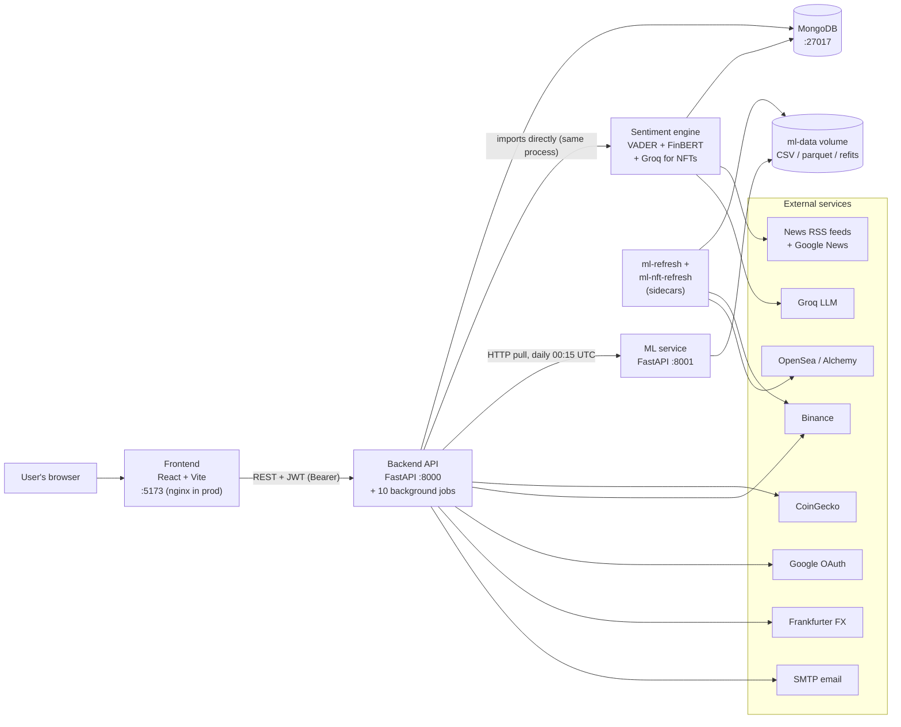

# 03: System Design

## Architecture diagram

## What each component does

- **Frontend (`frontend/`)**: a single-page app (SPA = one HTML page; JavaScript swaps views). `App.jsx`
  draws the sidebar + topbar shell. `routes.js` maps URLs to pages. All API calls go through
  `services/apiClient.js`.
- **Backend API (`backend/`)**: FastAPI app in `main.py`. Routes in `routes/` are thin. Business logic
  is in `controllers/`. All DB queries are in `db/queries.py`. It owns users, portfolios, alerts and the AAI score.
- **Background jobs (inside the backend)**: started as daemon threads in `main.py` `on_startup`:
  market data (2 min / 15 min), sentiment (15 min), AAI refresh (30 min), alerts (5 min), portfolio
  snapshots (hourly), FX (6 h), ML pull (daily), asset profiles, insights, NFT sentiment (30 min).
- **Sentiment engine (`sentiment_engine/`)**: a Python package that the backend imports directly (not
  over HTTP). It collects news, scores it with NLP and blends it with market signals into a score from -1 to +1.
- **AAI engine (`aai_engine/aai.py`)**: one small pure function, `compute_aai()`, plus normalisers. Kept
  separate so the backend and tests can both import it.
- **ML service (`ml/`)**: its own FastAPI app (`ml/api/service.py`). It serves `/predict/{asset}`,
  `/risk/{asset}` (BTC, ETH, SOL) and NFT endpoints (floor, risk, sales, item fair value). It keeps its
  own data on a Docker volume.
- **ML sidecars**: `ml-refresh` re-downloads and validates crypto data daily at 00:05 UTC.
  `ml-nft-refresh` pulls NFT data at 00:10 UTC and refits the fair-value model monthly.
- **MongoDB**: one store for app data. TTL indexes clean up sessions and rate-limit rows on their own.

## Request flow: user logs in

1. User types email + password on `LoginPage.jsx`. `services/authApi.js` calls `POST /auth/login`
   through `apiFetch()`.
2. Backend `routes/auth.py` `login()` lowercases the email.
3. **Rate-limit check**: `auth/rate_limit.py` `check()` counts recent failed attempts in `auth_attempts`
   (max 5 per account+IP and 30 per IP, per 15 min). Over the limit means **429** with `Retry-After`.
4. `db/queries.get_user_by_email()` loads the user. `auth/security.verify_password()` checks the bcrypt hash.
5. On failure, the attempt is recorded and the API returns **401 "Invalid email or password"**. The same
   message is used for "no such user", so an attacker can't tell which part was wrong.
6. On success, `_issue_token()` inserts a row in **`user_sessions`** (user agent, IP, expiry in 24 h).
   Then `create_access_token()` signs a JWT holding `sub` (user id), `sid` (session id) and `exp`.
7. Frontend stores the token in `localStorage` (`hooks/useAuth.js` `setSession`) and goes to the dashboard.
8. Every later request sends `Authorization: Bearer <token>`. `auth/dependencies.py`
   `get_current_session()` decodes it **and** checks that the session row still exists. Deleting the row
   (logout, password change) kills the token at once.
9. After a token passes half its life, `services/sessionRefresh.js` calls `POST /auth/refresh` in the
   background. This is a sliding session: 24 h of inactivity or 30 days in total signs you out.

## Folder structure

| Folder | What lives there |
|---|---|
| `frontend/src/pages/` | One file per page (`DashboardPage.jsx`, `PortfolioPage.jsx`, …) |
| `frontend/src/components/<area>/` | UI pieces grouped by page (dashboard, portfolio, sentiment, nft, …) |
| `frontend/src/services/` | API wrappers per area (`portfolioApi.js`, `authApi.js`, …) + `apiClient.js` |
| `frontend/src/errors/` | Error catalog, toasts, error boundary, offline banner |
| `frontend/src/utils/` | Pure helpers + their tests (`volCone.js`, `nftSentiment.js`, …) |
| `backend/main.py` | App setup, global error handlers, CORS, router list, background-job startup |
| `backend/routes/` | HTTP endpoints, one file per area |
| `backend/controllers/` | Business logic and schedulers (alerts, holdings, market data, ML pull, …) |
| `backend/auth/` | Password hashing, JWT, Google OAuth, rate limits, the `get_current_user_id` dependency |
| `backend/models/schemas.py` | All Pydantic request/response models |
| `backend/utils/` | Error messages + secret redaction, mailer, scheduler lock (`scheduler_gate.py`) |
| `db/` | Mongo connection, all queries (`queries.py`), indexes, seed scripts + `seed_guard.py` |
| `aai_engine/` | The AAI formula |
| `sentiment_engine/` | collectors → nlp → aggregator → storage; `nft_sentiment/` for the Groq path |
| `ml/` | data, features, labels, models, evaluation, nft, serving, api, docs, reports, tests |
| `shared/` | `mock_data.py` (older mock data) |

## How it's deployed and runs

- **Local / dev:** `cp .env.example .env` then `docker compose up --build` (see `DOCKER.md`).
  Frontend runs at :5173, backend docs at :8000/docs, ML docs at :8001/docs.
- The backend image is built **from the repo root**, because it also copies `sentiment_engine/`,
  `aai_engine/`, `db/` and `shared/`. It is several GB because of torch (needed by FinBERT).
- Source folders are bind-mounted **read-only** into containers, so no container can write into the repo.
- The backend's database defaults to the local `mongodb` container. Seed scripts refuse to write to a
  remote DB unless given `--allow-remote` (`db/seed_guard.py`, decision D69).
- **Production frontend:** `frontend/Dockerfile.prod` builds static files and serves them with nginx
  (`nginx.conf` sends unknown paths to `index.html` so client-side routes work).
- **Where it is hosted publicly:** TODO: confirm. No CI pipeline or cloud config was found in the repo.
