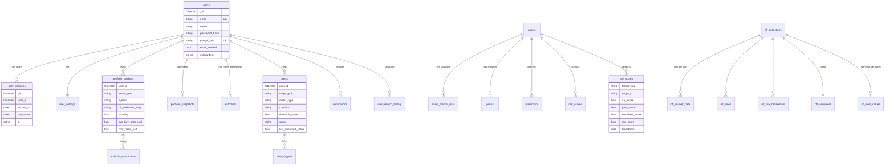

# 04: Data and Features

## Database (MongoDB)

There are **two databases** on the same Mongo server:
- `MONGO_DB_NAME` (default `aaip_db`): the backend's data (~33 collections).
- `MONGO_DB` (default `altinvest`): the sentiment engine's `sentiment`, `sentiment_history`, `raw_articles`.

All indexes are listed in one place: `db/indexes.py` (created at startup). MongoDB has no foreign keys.
The links below are by convention: a `user_id` field holds the user's `_id`.

**Collections that matter most**
- `users`: email (unique), bcrypt `password_hash` (null for Google-only users), `google_sub`, onboarding answers.
- `user_sessions`: one row per sign-in. The JWT's `sid` points here. Deleting the row revokes the token.
- `auth_attempts`: rate-limit counters. A TTL index deletes them on their own.
- `portfolio_holdings` + `portfolio_transactions`: what the user holds, and every buy, sell or adjustment.
- `alerts`, `alert_triggers`, `notifications`: rules, their firing history and the in-app inbox.
- `asset_market_data` (CoinGecko), `prices` (Binance hourly), `predictions` / `risk_scores` (ML),
  `aai_scores`: per-asset time series, indexed on `(asset, timestamp DESC)` so "latest row" queries are fast.
- `nft_*` (10 collections): NFT floors, sales, liquidity, risk, sentiment, item values.
- Other: `market_insights`, `sentiment_themes`, `fx_rates`, `scheduler_runs` (job locks).

## API endpoints

Base URL: `http://localhost:8000`. There is no `/api` prefix. 🔒 = needs a login token.
"Optional" = works without login, but personalises the result if you are logged in.

| Method | Route | What it does | Auth |
|---|---|---|---|
| POST | `/auth/signup`, `/auth/login` | Create account / sign in, returns JWT | No |
| POST | `/auth/google` | Sign in with a Google auth code | No |
| GET | `/auth/providers` | Which sign-in providers are set up | No |
| POST | `/auth/forgot-password`, `/auth/reset-password`, `/auth/verify-email` | Email-link flows | No |
| GET | `/auth/me` | Current user | 🔒 |
| POST | `/auth/refresh`, `/auth/logout`, `/auth/change-password` | Session management | 🔒 |
| GET/POST/DELETE | `/auth/sessions`, `/auth/sessions/revoke-others`, `/auth/sessions/{id}` | List and revoke devices | 🔒 |
| POST | `/auth/google/link`, `/auth/google/unlink`, `/auth/resend-verification` | Account linking | 🔒 |
| DELETE | `/auth/account` | Delete account | 🔒 |
| GET | `/assets`, `/assets/{symbol}/detail` (+ `/header`, `/performance`, `/intelligence`, `/risk`, `/market-stats`) | Asset catalog and detail page data | Optional (detail) |
| GET | `/aai/{asset}`, `/prediction/{asset}`, `/risk/{asset}` | AAI score, ML forecast, ML risk | No |
| GET | `/sentiment`, `/sentiment/{asset}`, `/sentiment/{asset}/history`, `/sentiment/themes`, `/sentiment/mood-trend` | Sentiment readings | No |
| POST | `/sentiment/{asset}/refresh`, `/sentiment/refresh`; GET `/sentiment/refresh/status` | Force a re-run of the pipeline | No ⚠️ |
| GET | `/dashboard/stats`, `/dashboard/performance` | User's portfolio summary and chart | 🔒 |
| GET | `/dashboard/insights`, `/dashboard/trending`, `/dashboard/trending-collections` | Market-wide cards | No / Optional |
| GET/POST/PATCH/DELETE | `/portfolio/holdings[/{id}]`, `/portfolio/holdings/{id}/transactions` | CRUD on holdings, buy/sell | 🔒 |
| GET | `/portfolio/summary`, `/performance`, `/allocation`, `/intelligence`, `/transactions` | Portfolio analytics | 🔒 |
| GET/POST/PATCH/DELETE | `/watchlists[/{id}]`, `/watchlists/{id}/items[/{symbol_or_slug}]` | Watchlists | 🔒 |
| GET/POST/PATCH/DELETE | `/alerts[/{id}]`, `/alerts/triggers`, `/alerts/{id}/triggers` | Alert rules and history | 🔒 |
| GET/POST/PATCH/DELETE | `/notifications`, `/unread-count`, `/read-all`, `/{id}/read`, `/{id}` | Inbox | 🔒 |
| GET | `/nft/collections[/{slug}]`, `/nft/sentiment…`, `/nft/collections/{slug}/tokens/{id}`, `/…/items/{id}/value` | NFT data and fair value | No |
| GET | `/discover`, `/discover/options` | Filterable universe (`X-Total-Count` header for paging) | Optional |
| GET | `/compare`, `/compare/candidates` | Side-by-side comparison | Optional |
| GET | `/search`; GET/POST/DELETE `/search/history` | Global search; recent searches | No / 🔒 |
| GET/PATCH | `/profile`, `/settings`, `/settings/{section}` | Profile and settings | 🔒 |
| GET | `/fx`, `/health`, `/` | Exchange rates, health check | No |

**ML service (:8001, called only by the backend):** `/predict/{asset}`, `/risk/{asset}`, `/health`,
`/nft/collections`, `/nft/{slug}/floor|risk|sales`, `/nft/{slug}/items/{token_id}/value`, `/nft/items/value`.

## Feature 1: AAI score (the core idea)

**Formula** (`aai_engine/aai.py` `compute_aai`): `AAI = 0.40 × pred + 0.30 × sentiment + 0.30 × risk`, clamped to 0-100.

1. **ML data in:** `controllers/ml_pull_controller.py` `pull_all` calls the ML service's `/predict` and
   `/risk` (at startup and daily at 00:15 UTC). It uses a 10 s timeout and 3 retries with backoff
   (2, 4, 8 s). If a call fails, nothing is written, so the last good row stays the newest.
   Rows go into `predictions` and `risk_scores`.
2. **Normalising** (`controllers/aai_controller.py` `compute_aai_response`):
   - pred: the expected 30-day return is mapped linearly: -20% → 0, 0% → 50, +20% → 100 (`normalise_expected_return`).
   - sentiment: -1..+1 → 0..100. It is then **shrunk toward 50 by confidence**:
     `conf × raw + (1 − conf) × 50`. A low-confidence reading counts as about neutral.
   - risk: already 0-100 from ML. Higher = safer. It is `100 × (1 − percentile of today's 30-day volatility)`
     across BTC/ETH/SOL history (decision D36).
3. If the prediction or risk is missing, the score is **null**. `missing_inputs` and a `note` say why. Nothing is made up.
4. `run_aai_refresh_scheduler` stores complete scores in `aai_scores` every 30 min for Discover, Compare and Watchlists.
5. `market_controller.aai_signal`: ≥55 = BUY, ≥45 = HOLD, else SELL. The frontend shows this in `AaiScoreCard.jsx`.
6. **Honesty detail:** no price model beat the "no change" baseline, so ML serves `prediction_30d = 0`.
   The pred part is therefore a neutral 50, and the API adds `BASELINE_NOTE` to say so.

## Feature 2: Sentiment pipeline

`sentiment_engine/aggregator/sentiment_aggregator.py` `run_pipeline(asset)`:
1. **Collect:** `collectors/rss_collector.py` (10 publisher feeds, fetched once per 10 min for every
   asset by `feed_cache.py`) + `news_search.py` (Google News search per coin, filtered for spam and
   for wrong coins like "Bitcoin Cash").
2. **Score:** `nlp/ensemble_scorer.py` gives each article `0.35 × VADER + 0.65 × FinBERT`, weighted by
   source trust. If FinBERT fails, VADER is used alone.
3. **Weight** by recency (`recency_weighter.py`). Compute confidence from volume (`volume_weighter.py`).
4. **Blend:** 70% news NLP + 30% market signals (CoinGecko/Binance price, volume, dominance, via `market_collector.py`).
5. **Trend:** compare with the reading about 24 h ago. A change > 0.05 = improving / deteriorating.
6. **Store:** `storage/mongo_handler.py` `save_sentiment`. It has a circuit breaker: after a Mongo
   failure it skips Mongo for 30 s.

Backend side (`backend/routes/sentiment.py`): a 20-min cache, a **per-asset lock** so two requests
don't run the pipeline twice, a request time budget, and a scheduler that refreshes all 15 assets every 15 min.
The model is warmed up in a thread at startup (`_warmup_sentiment_engine`).
**NFT variant:** `nft_sentiment/groq_scorer.py` asks a Groq LLM for relevance, label, intensity and
"same story as" (this removes reworded duplicate stories). It uses a strict JSON schema and falls back to VADER + FinBERT.

## Feature 3: Portfolio tracking

- **Add holding:** `POST /portfolio/holdings` → `holdings_controller.add_holding`. The symbol must
  exist. If you already hold that crypto, the holding is **merged** with a weighted-average buy price.
  The cost basis is always computed by the server (the client can't send it). Each change is written to `portfolio_transactions`.
- **Buy/sell:** `trade()` uses the **average cost** method. Realised P&L = (sell price − average buy price) × quantity.
- **Valuation:** `get_valued_holdings()` prices crypto from `asset_market_data` and NFTs from the latest floor price.
- **Intelligence:** `portfolio_intelligence.build_intelligence`. Diversification = `(1 − Σ w²) × 100`
  (Herfindahl index; w = each position's share of value). Any position over 40% counts as "concentrated".
  Aggregate risk and sentiment are averages weighted by value.
- **History chart:** `snapshot_controller.record_snapshots` upserts one `portfolio_snapshots` row per user per day.
- **Related: alerts** (`alert_controller.evaluate_alerts`, every 5 min). An alert fires only on a
  **crossing** (was ≤ X, now > X), not every time the value is above X. It writes `alert_triggers` +
  `notifications`, emails the user if chosen, and pauses itself until re-armed.

## Authentication and authorization

- **Authentication** (who you are): see the login flow in 03. Passwords: bcrypt, 8 characters to 72 bytes.
  JWT HS256, 24 h, sliding refresh up to 30 days, tied to a `user_sessions` row.
- **Reset/verify tokens** are JWTs with a `purpose` claim (`password_reset` 30 min, `email_verify` 24 h).
  `decode_access_token` rejects any token with a `purpose`, so a reset link can't be used as a login.
- **Google:** popup → one-time code → backend swaps it at Google's token endpoint using the secret →
  verifies the ID token's signature (Google's JWKS public keys), audience and issuer → links by `google_sub`.
- **Authorization** (what you can do): every user-scoped route depends on `get_current_user_id`. Every
  query filters by `user_id` (e.g. `{"_id": alert_id, "user_id": user_id}`), so you can't read or edit
  someone else's data. There are no admin roles.
- **Rate limits:** `auth/rate_limit.py`, stored in Mongo so they survive restarts and are shared across workers.

## Error handling and validation

- **Validation:** Pydantic models in `models/schemas.py` with `Field` limits (e.g. `quantity > 0`, no NaN/Infinity).
  Some models use `extra="forbid"` (unknown keys are rejected). Business rules are checked in controllers
  (e.g. `alert_controller.validate_rule`). Bad input → 422.
- **Global handlers in `main.py`:** any `PyMongoError` → 503 "Unable to reach the database". Sentiment
  engine missing → 503. Any other exception → 500 with a generic message. The full traceback is logged
  with secrets masked (`utils/http_errors.redact`). Stack traces never reach the client.
- **External calls:** timeouts on every call. On failure the system keeps the last good data
  (ML pull, NFT pull, sentiment, FX).
- **Frontend:** `apiClient.js` has a 20 s timeout and turns failures into an `ApiError` with a `kind`
  (`network`, `timeout`, …) via `errors/errorCatalog.js`. A 401 clears the session and shows `SessionExpiredModal`.
  `ConnectionBanner` shows when the API can't be reached. `ErrorBoundary` catches crashes in a page.
